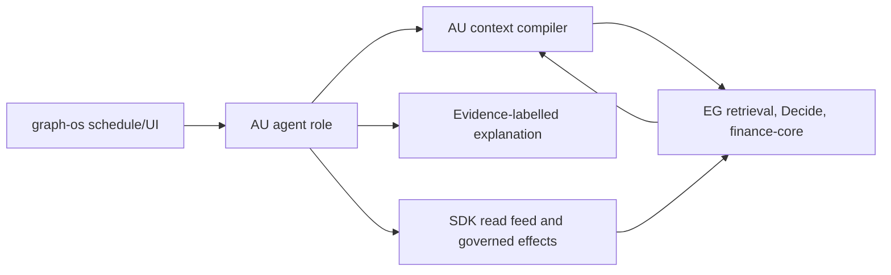

# Plan

1. Expose generated EG retrieval, context candidate, finance-core and Decide results plus SDK feed/write-back contracts with exact digest pins.
2. Route AU context compilation through those results. Add tokenizer-exact package selection, provenance retention and invalidation checks.
3. Wire shadow re-embedding and admission feedback as governed proposals; EG activates only after independent receipts and rollback proof.
4. Cut AU finance roles over to EG math and SDK feeds. Verify result parity on fixed public fixtures before deleting duplicated implementations.
5. Expose explanation and paper workflows through graph-os. Keep live action behind a separate verified approval lease. Run full tests and publish exact-head evidence.

## Design

### Reuse and ownership

Reuse `agent_utilities/knowledge_graph/retrieval/context_compiler.py`, `context_plane.py` and `capability_index.py` for agent-side composition, but replace local retrieval-engine authority with generated EG methods. Reuse `agent_utilities/domains/finance/{trading_swarm,investor_debate,research_autopilot,persona_heuristics}.py` only for agent roles. `agent_utilities/domains/finance` currently also contains deterministic math and feed modules. Migrate their behavior to EG/SDK, then delete copies. Reuse the existing AU orchestration capacity and approval ports. Introduce a typed port only when no current one expresses the contract.

### Context interface

`ContextRequest` contains verified principal/tenant/graph, task class, schema digest, RunSpec digest, tokenizer ID/version, token window, cost and latency ceilings, and cited source bounds. EG returns typed candidates with proof/claim class, source revision, rank receipt and invalidation epoch. AU chooses a package only from allowed candidates, with exact token counts and deterministic tie ordering. It records what was excluded and why. If source revision or invalidation epoch changes before use, AU re-queries or abstains.

### Finance interface

`AnalysisRequest` contains verified account scope, holding/watchlist IDs, strategy version, as-of time, horizon and risk budget. EG returns durable positions, market observations, deterministic indicators and calibration/scorecard receipts; SDK provides source freshness and account read effects. AU's `AnalysisSnapshot` binds all inputs and claims, records confidence/abstention reason and carries `informational_only=true`. A separate `ActionIntent` may be sent only to the SDK write-back API with approval lease and idempotency key. The SDK/EG confirm resulting state; AU never directly submits an exchange order.

### Failure rules

Stale source, missing citation, unknown tokenizer, budget overrun, uncalibrated strategy, insufficient effective sample size, invalid lease, cross-account request or changed idempotency payload fails closed or yields typed abstention. AU never substitutes an LLM estimate for deterministic finance math. Unavailable EG/SDK means the output is unavailable, not silently sourced from a local cache.

### Quality

Preserve one owner for every calculation and transport. Apply CCCC to route/context complexity, jscpd and dupehound to copied finance/retrieval code, and KISS to avoid second ranking/approval engines. Pin generated contracts and use normal Ruff, mypy, Pytest and repository hooks.

## Whole-prompt window fit (AU-CONTEXT-R004.1 to R004.6)

Data flow: `context_compiler_serving.py:565 -> compile_model_context (core/contextual_model.py:752) -> sizing_scope (context_knapsack.py:341) -> window check -> WindowFit -> ContextOverWindow | compiled bundle -> run trace`.

Types: `WindowFit` and `ContextOverWindow` are new. `ContextSizer`, `Capacity`, `TokenCounter` and `fit_to_budget` (`context_knapsack.py:422`) are reused. The check shares the sizer's tokenizer so the count matches the knapsack.

Failure: an uncountable prompt abstains. An over-window prompt never truncates silently. The engine sets the context policy, window budget and decomposition plan. This spec applies the budget and returns the prompt.

Decision: detect once at the sizing scope, where the tokenizer and capacity already live. The rejected alternative is a second counter inside the decomposition code, and that count drifts from the knapsack count.

Existing code: `agent_utilities/knowledge_graph/retrieval/context_knapsack.py:303`, `:98`, `:422`; `agent_utilities/core/contextual_model.py:752`. Reachable today: yes for knapsack sizing, no for whole-prompt fit.
Moves to EG-DECISION-ENGINE: the knapsack item selection and package choice in `context_knapsack.py:422` (`fit_to_budget`); the engine decides the context policy and budget.
Cross-repository rows: EG-DECISION-ENGINE-R137 — the context policy, window budget, over-window margin and decomposition plan the harness receives.
