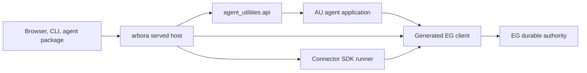

# Implementation plan

1. Freeze the public owner map and an old-operation inventory; classify unique gateway, MCP and deployment behavior.
2. Ship EG and SDK generated contracts first, then arbora served routes, then AU API adapters. Pin exact compatible versions before cutting callers.
3. Cut served shell, connector lifecycle, graph/semantic state, and cross-cutting state in dependency order. Each PR identifies the requirement IDs it closes and proves a complete vertical path.
4. Remove old AU imports, modules, scripts, dependencies and stale tests in the same change that activates replacement wiring.
5. Add a generated owner-manifest rule plus import/script census to prevent reversal. Run full gates and record exact merged-head evidence.

The published specification is independently implementable. Cross-repository owners may keep their own specs. This file states all AU requirements, decisions and acceptance criteria for this cut.

## AU-BOUNDARY-R049: governed write-back execution

The new module `knowledge_graph/enrichment/writeback/governed.py` adapts AU sinks to the SDK write-back port. `SinkGrant` carries the grant that `run_writeback` already resolved: target, enable flag, risk tier and approval. `build_change_set` projects the sink operations to canonical JSON in one `ops` field. It drops private keys and injected clients. The authorization mode is `proposal_approval` for an approved replay and `standing_policy` otherwise. `SinkWriteBackTransport` runs the sink on a worker thread for `preview` and `apply`. A sink exception during `apply` becomes `OutcomeUncertainError`, and the caller receives the original error. `reconcile` reports `outcome_uncertain`, because a sink has no read-back.

A dry run registers its change set in a temporary `FileWriteBackLedger`, because it records no effect. A live apply uses one `FileWriteBackLedger` directory per change set under `runtime_dir()/writeback-ledger`. `FileAuditReservation` writes the audit reservation in the same directory before the sink call. The EG-backed `EpistemicGraphWriteBackLedger` replaces the file ledger when arbora serves the EG `WriteBack` operation. arbora needs no code change: it serves `graph_writeback` from the AU tool registry. ARBORA-FLEET-R003 remains the arbora obligation for a typed, previewed write-back operation.

Known limits: each invocation is a new change set, so the SDK idempotency key does not deduplicate a repeated call. Sink-level external-id stamps still deduplicate creations. The source version comes from the caller signals `expected_source_version` and `current_source_version`, or it is `unversioned`.

## Design

### Boundaries

AU layers are pure versioned application contracts, domain policy, use cases, protocols, runtime adapters, and composition. Dependencies point inward. Only composition chooses concrete model, EG client, harness and clock adapters. The arbora server admits authenticated requests, then calls an AU API method; it does not import AU internals. The SDK fetches source data and submits generated EG requests; no AU connector wrapper remains. EG alone commits graph, job, memory and usage facts.

### Existing wiring to reuse

- `agent_utilities.arbora_client` is the AU boundary to arbora (ARBORA-*). Do not expose `knowledge_graph/core/engine.py` directly.
- `agent_utilities/knowledge_graph/backends/epistemic_graph_backend.py` already illustrates a thin engine adapter. Reuse generated `epistemic_graph` client types and digest checks, then retire duplicated backend dispatch branches.
- `agent_utilities/knowledge_graph/retrieval/context_compiler.py` is retained as application context composition; graph search/ranking moves to EG methods.
- `agent_utilities/observability/` retains agent telemetry emission while durable trace and usage records live in EG.
- `arbora` already owns gateway and fleet composition. Compare each AU-only gateway module and drifted duplicate before deleting it; port unique behavior only to its legal host.

### Cutover algorithm

1. Pin a released EG client contract and enumerate consumers using AST imports plus runtime registry/script discovery. Build a machine-readable operation and module inventory with public paths only.
2. For each old entry point, write a typed new-owner request/result and a contract test. Include identity, tenant, graph, purpose, policy version, timeout, idempotency key, source digest and outcome receipt where relevant.
3. Wire one real public caller through the new route. Run a parity fixture against old and new behavior, including refusal cases. Move data only with verified tenant/source binding.
4. Delete the AU duplicate, stale tests and dependency declarations atomically with the caller cut. The owner-manifest check fails if imports, scripts or stale route registration remain.
5. Regenerate all owner manifests and public API references from source authority. Document intentional drops with a reason and a test proving the old operation is unavailable.

### Failure behavior

Contract mismatch, unknown tenant, absent authorization, duplicate idempotency key with different payload, corrupt legacy record, unsupported operation, or unavailable owner service fails closed with typed errors. No local fallback reads a different state authority. Retryable transport failure may retry only an idempotent request with the same key.

### Design constraints

Keep one owner per capability. Check copied code with jscpd and dupehound and use CCCC complexity reports to split oversized cutover adapters. Apply KISS by deleting obsolete wrappers rather than creating a second translation registry. Every change needs the language-native lint/type/test gate and this repository's normal pre-commit gate.

### Recorded owners for deletion rollups

#### AU-BOUNDARY-R002.3.1: ephemeral loopback OIDC certification authority

Finding (arbora `main` at `9095a5c`, read-only search): arbora has NO replacement for `EphemeralLoopbackOidcAuthority`, `AUTHORITY_MODE`, `DEFAULT_TOKEN_TTL_SECONDS` or `validated_token_ttl_seconds`. `git grep -n -i "loopback.*oidc\|certification_oidc" -- arbora` prints nothing. The only related arbora code is `arbora/deployment/doctor_certification.py`, which merely reports the `ephemeral-https-loopback` authority mode, and `specs/public-ingress-identity` IN-05, which specifies a fake OIDC issuer fixture but delivers no module.

Result: no arbora owner exists yet, so this row stays SPECIFIED. Cross-repo dependency: arbora must first own an authority (a new arbora module, or a reviewed decision that the skill-certification flow is deleted) before `AU-BOUNDARY-R002.3.2` to `AU-BOUNDARY-R002.3.5` can proceed. Do not delete `certification_oidc.py` until then.

## Coverage

This map routes each AU capability to the specification that owns it and, in the second half, routes each AU package directory to the requirement that removes, relocates or keeps it. A mention here is a routing decision, not acceptance. The sibling specs contain the complete AU behavior, design and test contract. A capability can have a separate owner implementation in another public repository; AU completion still requires its own caller and deletion proof.

| AU capability or disposition | Native spec | Requirement definitions |
|---|---|---|
| Agent execution, routing, swarm, task claims | [`agent-control-plane`](../agent-control-plane/spec.md) | [requirements](../agent-control-plane/requirements.md) |
| Harness capture, training, work market and governed change | [`harness-evolution`](../harness-evolution/spec.md) | [requirements](../harness-evolution/requirements.md) |
| Security, identity, guardrails and cache invalidation | [`agent-security-policy`](../agent-security-policy/spec.md) | [requirements](../agent-security-policy/requirements.md) |
| Portable tests, liveness and type coverage | [`au-boundary-quality`](../au-boundary-quality/spec.md) | [requirements](../au-boundary-quality/requirements.md) |
| Semantic schema and generated EG client | [`au-semantic-client`](../au-semantic-client/spec.md) | [requirements](../au-semantic-client/requirements.md) |
| Served, connector, graph and state authority cuts | [`au-boundary-deconstruction`](spec.md) | [requirements](requirements.md) |
| Cross-cutting audit of duplicate graph engine code | [`au-engine-duplicate-retirement`](../au-engine-duplicate-retirement/spec.md) | [requirements](../au-engine-duplicate-retirement/requirements.md) |
| Retrieval/context and finance agent roles | [`agent-context-and-finance`](../agent-context-and-finance/spec.md) | [requirements](../agent-context-and-finance/requirements.md) |
| Public contributor environment and skill lifecycle | [`au-developer-environment`](../au-developer-environment/spec.md) | [requirements](../au-developer-environment/requirements.md) |
| Final composition, ontology/SHACL/OWL clean cut, public application control plane and public documentation | [`au-integration-reliability`](../au-integration-reliability/spec.md) | [requirements](../au-integration-reliability/requirements.md) |

Where a capability has more than one owner, the native AU spec describes its own boundary and explicit input/output contract; it does not make another repository's implementation state an AU acceptance claim. Each contributor must confirm the current source tree and evidence at the exact head before moving a task state.

### Deletion and relocation inventory

One row per directory in the top two levels under `agent_utilities/`. It states what this spec and [`au-engine-duplicate-retirement`](../au-engine-duplicate-retirement/spec.md) say happens to that directory, and which requirement in [requirements.md](requirements.md) or the [retirement requirements](../au-engine-duplicate-retirement/requirements.md) covers it. The cut is complete when every row has a disposition other than "undecided" and every covering requirement is delivered.

How to read it:

- **Approx. lines** counts every tracked file under the directory, including data files and any child directory that has its own row. The package totals 1,973 tracked files and about 802,000 lines.
- **Disposition** is taken from the requirement text. "Split" means the requirements send different files to different owners. "Undecided" means neither spec names the directory or its files; the note then states only what the directory contains. A directory marked "undecided" is not thereby kept: no requirement says so either.
- A requirement that deletes an AU copy because another repository already owns the behavior is shown as a relocation to that repository.
- "AU-RETIRE-R001 (inventory obligation only)" marks a `knowledge_graph/` directory that AU-RETIRE-R001 requires to receive a disposition but for which no requirement states one.
- Short paths in requirement text such as `core/…`, `enrichment/…`, `ontology/…` and `kg/…` are read as relative to `agent_utilities/knowledge_graph/` where no directory of that name with that file exists directly under `agent_utilities/`.

| Directory | Approx. lines | Disposition | Covering requirement ID(s) | Notes |
|---|---:|---|---|---|
| `agent_utilities/` | 802,061 | split: relocate to agent-connector-sdk (`base_utilities.py`). Relocate to arbora (`release_catalogs.py`). Keep in AU (package metadata and small helpers) | AU-BOUNDARY-R010, AU-BOUNDARY-R014, AU-BOUNDARY-R046 | Count is the whole package. 12 files sit directly here (2,060 lines). The 10 remaining top-level files (681 lines) are package metadata and small helpers: `__init__.py`, `__main__.py`, `api_utilities.py`, `content.py`, `file_safety.py`, `nested_context.py`, `_version.py`, two JSON catalogs and `py.typed`. |
| `agent_utilities/agent/` | 2,203 | keep in AU | AU-BOUNDARY-R043 | Agent factory, registry builder, sampling profiles and capability resolver; retained agent-execution surface. 2 of 8 modules import `knowledge_graph` and must reach it only through the engine's public client. |
| `agent_utilities/agent_chat/` | 54 | keep in AU | AU-BOUNDARY-R043 | One chat-input parser module and a README; retained runtime and developer tooling. |
| `agent_utilities/analysis/` | 287 | keep in AU | AU-BOUNDARY-R043 | A single `analyzer.py` module; retained runtime and developer tooling. |
| `agent_utilities/automation/` | 2,644 | split: relocate to agent-connector-sdk (`worldmodel_pipeline.py`, `feed_sources.py`, `file_watcher.py`). Keep in AU (`research_pipeline.py`, `__init__.py`) | AU-BOUNDARY-R025, AU-BOUNDARY-R046 | `research_pipeline.py` (1,517 lines) is the LLM-driven research workflow piece and stays with the retained agent surface. |
| `agent_utilities/caching/` | 898 | keep in AU | AU-BOUNDARY-R047 | Semantic cache and prompt cache modules. Becomes a thin client over the engine, with no second cache authority. 2 of 3 modules import `knowledge_graph`. |
| `agent_utilities/capabilities/` | 5,799 | keep in AU | AU-BOUNDARY-R043 | Agent capability implementations (governed dynamic workflow, output repair, guardrails, checkpointing, model fallback); retained agent-execution surface. `kg_audit_sink.py` and `eg_history_source.py` read or write graph state and must do so only through the engine's public client. |
| `agent_utilities/capabilities/compaction/` | 100 | keep in AU | AU-BOUNDARY-R043 | Context-compaction helpers for agent runs; retained agent-execution surface. |
| `agent_utilities/claude_harness/` | 930 | keep in AU | AU-BOUNDARY-R043 | Coding-harness guard modules: a fence, a pre-tool-use check and an unattended runner. Retained runtime and developer tooling. |
| `agent_utilities/cli/` | 1,190 | keep in AU | AU-BOUNDARY-R043 | The unified `agent-utilities` command line entry point; retained runtime and developer tooling. It imports `governance/`, which R037 relocates, so that import must be removed or repointed. |
| `agent_utilities/core/` | 36,947 | split: relocate to agent-connector-sdk (6 modules); relocate to arbora (9 modules); relocate to epistemic-graph (3 modules); `config.py` split three ways; keep in AU (35 modules) | AU-BOUNDARY-R010, AU-BOUNDARY-R014, AU-BOUNDARY-R016, AU-BOUNDARY-R020, AU-BOUNDARY-R046 | Count includes the three child rows. 54 files sit directly here. The 35 modules that stay (15,441 lines) are model factory and providers, model routing and concurrency, schedulers, sessions, embedding utilities and resource budgeting, matching the agent/model third of the `config.py` split. |
| `agent_utilities/core/checkpoint/` | 769 | keep in AU | AU-BOUNDARY-R043 | One checkpoint manager module; retained agent-execution surface. It uses a SQL store and imports `knowledge_graph`, which must become a thin client over the engine rather than a second durable store. |
| `agent_utilities/core/execution/` | 984 | keep in AU | AU-BOUNDARY-R043 | Unified execution contract package: protocol, adapters, provider proxy, stream handlers; retained agent-execution surface. |
| `agent_utilities/core/registry/` | 3,118 | split: delete as duplicate of engine (`kg_adapter.py`); keep in AU (`package_adapter.py`, `package_types.py`, `plugin_adapter.py`, `service_adapter.py`) | AU-BOUNDARY-R019, AU-BOUNDARY-R046 | `kg_adapter.py` (1,802 lines) is replaced by the engine composition in `api/`. The service, package and plugin adapters (4 files, 1,316 lines) are non-graph registry plumbing and stay. |
| `agent_utilities/data/` | 16 | relocate to arbora, together with its consumers | AU-BOUNDARY-R048 | One 16-line MCP configuration JSON file, read by `server/routers/interop.py` and `mcp/check_env_var_drift.py`. Operator ruling 2026-10-03: moves with those consumers in a later wave; not moved now. |
| `agent_utilities/data_prep/` | 4,481 | relocate to agent-connector-sdk | AU-BOUNDARY-R024 | Named wholesale as `data_prep/**`. |
| `agent_utilities/data_prep/certification/` | 643 | relocate to agent-connector-sdk | AU-BOUNDARY-R024 | Covered by the parent glob. |
| `agent_utilities/decide/` | 4,182 | keep in AU | AU-CONTROL-R010, AU-CONTROL-R015, AU-CONTROL-R019 | AU's consumers of the engine's Decide layer: decision points that keep their old rule as the deterministic fallback, the reference topology templates (`topology/templates.py`), the topology consumer (`consumers/topology.py`) and the narrow-only swarm continuation point (`consumers/continuation.py`). |
| `agent_utilities/deployment/` | 19,006 | relocate to arbora | AU-BOUNDARY-R002 | Named wholesale as `deployment/**`; the console scripts that target it go with it. |
| `agent_utilities/domains/` | 13,947 | split: see child rows | AU-BOUNDARY-R041, AU-BOUNDARY-R048 | Count includes the child rows; only a 53-line `__init__.py` sits directly here. `domains/finance/` is split under R041 and a sibling spec; `domains/government/`, `domains/hr/`, `domains/law/` and `domains/medical/` relocate to epistemic-graph under R048. |
| `agent_utilities/domains/finance/` | 12,991 | split: delete (12 modules that produced fabricated data); remainder undecided in these two specs | AU-BOUNDARY-R041 | R041 names 12 of the 45 modules. The other 33 (about 9,950 lines) are outside these two specs; [`agent-context-and-finance`](../agent-context-and-finance/spec.md) owns the remaining finance cut. |
| `agent_utilities/domains/finance_agents/` | 138 | keep in AU | AU-BOUNDARY-R043 | Flip explainer agent module kept outside the pinned finance-math set; retained agent-execution surface. |
| `agent_utilities/domains/government/` | 92 | relocate to epistemic-graph | AU-BOUNDARY-R048 | Typed domain models only; moves as a typed domain pack, then is deleted from AU. |
| `agent_utilities/domains/hr/` | 570 | relocate to epistemic-graph | AU-BOUNDARY-R048 | Typed domain models and a workforce manager module. Moves as a typed domain pack, then is deleted from AU. The MCP tool `mcp/tools/analysis_tools.py` that reads the workforce manager moves separately to arbora with MCP tool hosting (R003). |
| `agent_utilities/domains/law/` | 134 | relocate to epistemic-graph | AU-BOUNDARY-R048 | Typed domain models only; moves as a typed domain pack, then is deleted from AU. |
| `agent_utilities/domains/medical/` | 107 | relocate to epistemic-graph | AU-BOUNDARY-R048 | Typed domain models only; moves as a typed domain pack, then is deleted from AU. |
| `agent_utilities/ecosystem/` | 4,619 | split: relocate to arbora (`hook_installer.py`, `agent_manager_dashboard.py`). Relocate to agent-connector-sdk (`ea_clients.py`, `media/`). Relocate to epistemic-graph (`ard_federation.py`, `ard_registry.py`). Keep in AU (9 modules) | AU-BOUNDARY-R014, AU-BOUNDARY-R024, AU-BOUNDARY-R025, AU-BOUNDARY-R028, AU-BOUNDARY-R046 | The 9 modules that stay (2,237 lines) are `__init__.py`, `agents_md_reflector.py`, `bridge.py`, `config_staleness_auditor.py`, `governance_agent.py`, `governance_workflow.py`, `lint_enforcement_hook.py`, `permission_policy.py` and `plugin_bundle.py`. |
| `agent_utilities/ecosystem/media/` | 777 | relocate to agent-connector-sdk | AU-BOUNDARY-R025 | Named wholesale as `ecosystem/media/**`. |
| `agent_utilities/governance/` | 11,993 | relocate to repository-manager; relocate to epistemic-graph (`relational_authority.py`) | AU-BOUNDARY-R037, AU-BOUNDARY-R028 | The destination is repository-manager, which is none of the three target repositories. The `relational_authority.json` data file next to the module is not named. |
| `agent_utilities/graph/` | 699 | keep in AU | AU-BOUNDARY-R043.1, AU-BOUNDARY-R043.2 | The agent run loop: run state, bundle builder, executor and runner. It applies a received plan and holds no store or router. |
| `agent_utilities/harness/` | 28,964 | keep in AU | AU-BOUNDARY-R043 | Evaluation, optimization and self-improvement harness (78 direct files, 27,128 lines); retained evaluation and self-improvement surface. Includes trace, state and memory modules that hold durable records; the sibling [`harness-evolution`](../harness-evolution/spec.md) spec covers harness behavior in detail. |
| `agent_utilities/harness/memorydata/` | 1,836 | keep in AU | AU-BOUNDARY-R043 | Benchmark adapter for the served memory stack, with seven YAML configurations; retained evaluation surface. |
| `agent_utilities/harness/policy_evolution/` | 540 | keep in AU | AU-BOUNDARY-R043, AU-HARNESS-R001, AU-HARNESS-R002 | Capability-gated policy-trajectory capture (`capture.py`) and the external, leased training-job path (`training.py`); retained self-improvement surface under `harness/` (R043). The sibling [`harness-evolution`](../harness-evolution/spec.md) requirements AU-HARNESS-R001 (capture) and AU-HARNESS-R002 (external training) state its behavior. |
| `agent_utilities/httpsupport/` | 2,089 | relocate to agent-connector-sdk | AU-BOUNDARY-R010 | Named wholesale as `httpsupport/**`; deleted in AU once connectors use the SDK. |
| `agent_utilities/ingestion/` | 1,479 | relocate to agent-connector-sdk | AU-BOUNDARY-R025 | Named as the top-level `ingestion/**`. |
| `agent_utilities/ingestion/agent_sources/` | 1,174 | relocate to agent-connector-sdk | AU-BOUNDARY-R025 | Covered by the parent glob. |
| `agent_utilities/integrations/` | 257 | keep in AU | AU-BOUNDARY-R043 | One git issue and pull-request resolver module; retained runtime and developer tooling. |
| `agent_utilities/knowledge_graph/` | 347,980 | split by child row. Direct files: delete as duplicate of engine (`facade.py`). Relocate to epistemic-graph (2 worker modules). Relocate to arbora (`readiness.py`). Relocate to agent-connector-sdk (`governance_import.py`). Keep in AU (`__main__.py`). Remainder undecided | AU-BOUNDARY-R014, AU-BOUNDARY-R018, AU-BOUNDARY-R020, AU-BOUNDARY-R024, AU-BOUNDARY-R045, AU-RETIRE-R001 | Count is the whole subtree. 17 files sit directly here. 11 (about 3,650 lines) are still not named: the workflow store and compilers, the process-plan compiler, migrations, `_engine_protocol.py`, `durable_execution_kg.py` and `ontology.lock`. |
| `agent_utilities/knowledge_graph/actions/` | 1,837 | delete as duplicate of engine | AU-BOUNDARY-R022 | Deleted once native engine coverage is proven. |
| `agent_utilities/knowledge_graph/adaptation/` | 5,281 | keep in AU | AU-BOUNDARY-R045 | Failure analysis, feedback, belief revision, contradiction detection, skill evolution and remediation playbooks; retained as policy/proposal orchestration. `belief_revision.py`'s deterministic confidence-propagation math is flagged for a later review of whether that specific calculation belongs in the epistemic graph instead. |
| `agent_utilities/knowledge_graph/argumentation/` | 871 | delete as duplicate of engine | AU-BOUNDARY-R022 | Deleted once native engine coverage is proven. |
| `agent_utilities/knowledge_graph/assimilation/` | 4,807 | relocate to epistemic-graph | AU-BOUNDARY-R027 | Named wholesale. |
| `agent_utilities/knowledge_graph/backends/` | 12,810 | split: delete as duplicate of engine (`sparql/`); relocate to epistemic-graph (10 federation backends); keep in AU (`epistemic_graph_backend.py`, `base.py`, `__init__.py`) | AU-BOUNDARY-R032, AU-BOUNDARY-R033, AU-BOUNDARY-R045, AU-RETIRE-R001 | `epistemic_graph_backend.py` was previously kept only by design.md with no requirement ID; R045 is now its formal inventory owner. `base.py` defines the `GraphBackend` ABC that `epistemic_graph_backend.py` implements, and the 1,065-line `__init__.py` is the `create_backend()` factory that constructs it; both stay in AU as the retained backend's own infrastructure under R045, and may shrink further once R032/R033 finish moving every other backend out. AU-RETIRE-R001 also names `backends/owl/`, which does not exist. |
| `agent_utilities/knowledge_graph/core/` | 69,181 | split: delete as duplicate of engine (33 modules, including `fleet_catalog_tables.py`). Relocate to epistemic-graph (26 modules, including `markov_regime.py`). Relocate to agent-connector-sdk (6 modules). Relocate to arbora (2 modules). Remainder undecided | AU-BOUNDARY-R014, AU-BOUNDARY-R018, AU-BOUNDARY-R019, AU-BOUNDARY-R020, AU-BOUNDARY-R021, AU-BOUNDARY-R022, AU-BOUNDARY-R024, AU-BOUNDARY-R025, AU-BOUNDARY-R030, AU-BOUNDARY-R045, AU-RETIRE-R001, AU-RETIRE-R005, AU-RETIRE-R008 | 68 of 93 modules are now named. `fleet_catalog_tables.py` (2,790 lines) duplicates the engine's native fleet catalog and deletes. `markov_regime.py` duplicates epistemic-graph finance math and relocates alongside the domain/finance cut. The remaining 25 unnamed modules (about 7,800 lines) include `source_catalog.py` (1,004), `optimal_execution.py`, `nl_planner.py`, `ecosystem_topology.py`, `materialization.py`, `table_ingest.py` and `archimate_layer.py`. |
| `agent_utilities/knowledge_graph/distillation/` | 7,491 | keep in AU | AU-BOUNDARY-R045 | Skill-graph distillation pipeline, skill synthesizer, deduplicator and an LSH index; propose-only skill generation and loop orchestration. Source reads, skill publication and durable graph writes must go through the agent-connector-sdk and epistemic-graph public ports rather than a local implementation. |
| `agent_utilities/knowledge_graph/domain_packs/` | 1,650 | relocate to epistemic-graph | AU-BOUNDARY-R031, AU-BOUNDARY-R045 | Mapping evaluation, pack validation and graph schema authority (`dsl.py`, `pack_loader.py`, `domain_pack.py` and the rest). Moves once the shared pack loader is cut over to engine-generated types. The agent-connector-sdk supplies source records and manifest transport. |
| `agent_utilities/knowledge_graph/enrichment/` | 18,839 | split: relocate to agent-connector-sdk (extractors, write-back, git history, source adapters); relocate to epistemic-graph (6 deterministic modules); keep in AU (`cards.py`, `synthesize.py`, `distill.py`, `topic_classifier.py`, `pipeline.py`, `models.py`) | AU-BOUNDARY-R026, AU-BOUNDARY-R027, AU-BOUNDARY-R045, AU-RETIRE-R002, AU-RETIRE-R004, AU-RETIRE-R005, AU-RETIRE-R008 | The 6 modules that stay (about 6,040 lines together) are the LLM-driven card generation, synthesis and topic-classification workflow and its orchestration and data models; everything else in the directory now has a named destination. |
| `agent_utilities/knowledge_graph/etl/` | 1,600 | relocate to epistemic-graph | AU-BOUNDARY-R027 | Named wholesale. |
| `agent_utilities/knowledge_graph/extraction/` | 5,724 | split: relocate to agent-connector-sdk (readers, PDF); relocate to epistemic-graph (`schema_discovery.py`); keep in AU (fact extractor, structure router, job manager, candidate claims, ontology grounding, extraction schema, note-sync module) | AU-BOUNDARY-R025, AU-BOUNDARY-R030, AU-BOUNDARY-R045 | The 10 modules that stay (3,879 lines) are the model-backed LLM fact- and claim-extraction workflow that AU-BOUNDARY-R023 already says AU retains; R045 is now their formal inventory owner. |
| `agent_utilities/knowledge_graph/id_management/` | 369 | delete as duplicate of engine | AU-BOUNDARY-R022 | Deleted once native engine coverage is proven. |
| `agent_utilities/knowledge_graph/infra/` | 711 | relocate to epistemic-graph | AU-BOUNDARY-R028 | Named wholesale. |
| `agent_utilities/knowledge_graph/ingestion/` | 29,521 | split: relocate to epistemic-graph (commit and derivation half, including `manifest.py`, `staged_pipeline.py`, `batch_orchestrator.py`); relocate to agent-connector-sdk (10 source modules, plus `skill_classification.py`'s `SKILL.md` frontmatter write); delete as duplicate of engine (the fleet skill/prompt harvest modules); `engine.py` dissolved | AU-BOUNDARY-R022, AU-BOUNDARY-R023, AU-BOUNDARY-R024, AU-BOUNDARY-R025, AU-BOUNDARY-R045, AU-RETIRE-R006, AU-RETIRE-R007, AU-RETIRE-R008 | R023 names the directory and lists 14 modules; R024 and R025 name 10 more. The fleet skill/prompt harvest modules (about 400 lines) duplicate native fleet skill handling and delete. `manifest.py` (durable delta-ingestion checkpoint) and `staged_pipeline.py` (the non-blocking stage-queue decomposition of `engine.ingest`) are durable commit/queue infrastructure for `engine.py` and relocate alongside it under R023. `batch_orchestrator.py` owns the KG-side fan-out, idempotency and backpressure for enterprise repository ingestion (its companion remote enumeration already lives in repository-manager) and relocates under R023 too. `skill_classification.py` splits: its source-of-truth write (the skill's own `SKILL.md` frontmatter) is a content-pack mutation that belongs with the agent-connector-sdk's pack write-back; its durable-override fallback calls `core.fleet_catalog_tables.write_skill_classification_override`, which duplicates the engine's native fleet catalog (R022) and must move there instead once that module deletes. The AU-RETIRE requirements change `engine.py` and `embedding_admission.py` before they move. |
| `agent_utilities/knowledge_graph/integrations/` | 2,419 | split: relocate to agent-connector-sdk (connector certification, attestation and its CLI). Delete as duplicate of engine (legacy SPARQL sync and ingestor) | AU-BOUNDARY-R011, AU-BOUNDARY-R032 | Fully covered. |
| `agent_utilities/knowledge_graph/kb/` | 3,702 | split: relocate to agent-connector-sdk (`x_ingestion.py`). Keep in AU (`entity_claim_extractor.py`). Split (`ingestion.py`: parse/transport to the SDK, extraction to AU, graph write to epistemic-graph). Remainder undecided | AU-BOUNDARY-R025, AU-BOUNDARY-R045 | `entity_claim_extractor.py` (521 lines) is AU's model-backed candidate-claim extraction. `x_ingestion.py` (509 lines) is source transport and moves to the SDK. `ingestion.py` (764 lines) itself chains parse, Pydantic AI extraction, embedding and graph write, so it splits by step rather than moving whole. The other 8 files (about 1,908 lines) remain undecided. |
| `agent_utilities/knowledge_graph/live_artifacts/` | 414 | split: relocate to epistemic-graph (`store.py`). Keep in AU (`models.py`, `refresh.py`, `kg_source.py`, `__init__.py`) | AU-BOUNDARY-R045 | `store.py` keeps a process-local index and a best-effort writer through the legacy graph-write path. Durable artifact authority belongs to the epistemic graph. `models.py` and `refresh.py` are rendering and refresh policy and stay. `kg_source.py` is a read-only resolver that queries the KG and shapes the result for the gateway's artifact-refresh route. It holds no durable state of its own and stays alongside `refresh.py`. `__init__.py` is the package's export surface. It re-exports `LiveArtifactStore`/`get_live_artifact_store` from `store.py` today and needs that import repointed to the epistemic-graph client once `store.py` relocates. |
| `agent_utilities/knowledge_graph/maintenance/` | 1,801 | delete as duplicate of engine | AU-BOUNDARY-R022 | Deleted once native engine coverage is proven. |
| `agent_utilities/knowledge_graph/memory/` | 13,347 | relocate to epistemic-graph | AU-BOUNDARY-R040, AU-BOUNDARY-R027 | Everything moves; `timeseries/` under R027, the rest under R040. AU keeps only a thin engine client. |
| `agent_utilities/knowledge_graph/neural/` | 911 | relocate to epistemic-graph | AU-BOUNDARY-R034 | Named wholesale. |
| `agent_utilities/knowledge_graph/ontology/` | 69,600 | split: relocate to epistemic-graph (object model, emitters behind pack compilation). Relocate to agent-connector-sdk (connector manifest files, `sync_conflict`). Files kept for AU typing not listed | AU-BOUNDARY-R029, AU-BOUNDARY-R030, AU-BOUNDARY-R011, AU-BOUNDARY-R045 | Largest directory after `core`. R029 excepts "the files kept for AU's own semantic typing" without listing them. R045 is now the formal owner of that unlisted remainder. `leanix_metamodel` is sent to the SDK by R029 and behind engine pack compilation by R030. |
| `agent_utilities/knowledge_graph/orchestration/` | 6,187 | split: delete as duplicate of engine (8 `engine_*` modules); keep in AU (`research_orchestrator.py`, `research_subagent.py`, `data_analyst.py`, `voi_budget_controller.py`, `__init__.py`) | AU-BOUNDARY-R018, AU-BOUNDARY-R045 | The 5 modules that stay (1,300 lines) are the LLM-driven research loop's orchestrator, subagent, data analyst and value-of-information budget controller. |
| `agent_utilities/knowledge_graph/pipeline/` | 3,925 | delete as duplicate of engine | AU-BOUNDARY-R045 | Phased pipeline: scan, parse, embedding, SHACL check, sync, communities, centrality; plus document ingest, update and deletion. Legacy graph sync, parse and document-writer behavior that the agent-connector-sdk's source lifecycle and the epistemic graph's index/derivation path already cover; AU proves live callers and replacement behavior before deleting. |
| `agent_utilities/knowledge_graph/research/` | 19,712 | split: relocate to epistemic-graph (`placement_mining.py`); keep in AU (research loop controller, change publisher, evolution state, evidence, promotion governance, artifact compiler subpackage) | AU-BOUNDARY-R028, AU-BOUNDARY-R045 | The 36 modules that stay (17,567 lines) are the LLM-driven research loop, evolution state and claim flywheel; retained under the same behavioral carve-out as `distillation/` and `enrichment/`. |
| `agent_utilities/knowledge_graph/retrieval/` | 49,120 | split: relocate to epistemic-graph (18 retrieval engines). Keep in AU (`capability_index.py`, `context_compiler.py`). Remainder undecided | AU-BOUNDARY-R034, AU-BOUNDARY-R045 | `capability_index.py` and `context_compiler.py` are the "context compilation and the capability index" R034 already says AU retains, now named. 29 further modules (about 7,400 lines: context planes, query analysis, evaluation corpus, score checks) plus one generated JSON catalog (29,070 lines) remain undecided. |
| `agent_utilities/knowledge_graph/search/` | 2,473 | relocate to epistemic-graph | AU-BOUNDARY-R034 | Named wholesale. |
| `agent_utilities/knowledge_graph/search_synthesis/` | 786 | keep in AU | AU-BOUNDARY-R045 | Search-task synthesis over the graph: question formulation, evidence subgraph, shortcut-risk checks; an adversarial research workspace. `evidence_subgraph.py` must read the epistemic graph through a typed, tenant-scoped client instead of raw unscoped Cypher. |
| `agent_utilities/knowledge_graph/schema_drift/` | 1584 | relocate to agent-connector-sdk sync and the engine | AU-BOUNDARY-R035 | Source-record contract gate for connector sync: drift classification, quarantine and approved repair. Placed with the other drift handling under R035. |
| `agent_utilities/knowledge_graph/security/` | 2,462 | relocate to epistemic-graph | AU-BOUNDARY-R028 | Named wholesale. |
| `agent_utilities/knowledge_graph/shapes/` | 670 | relocate to epistemic-graph | AU-BOUNDARY-R045 | Eight SHACL shape files in Turtle; no Python. Ontology shape content belongs with the epistemic graph's pack compilation, matching the Turtle shapes already moving under the semantic-authority cut. |
| `agent_utilities/knowledge_graph/standardization/` | 1,322 | split: relocate to epistemic-graph; `drift.py` to agent-connector-sdk sync and the engine | AU-BOUNDARY-R028, AU-BOUNDARY-R035 | R028 moves everything except drift handling; R035 places drift handling. |
| `agent_utilities/knowledge_graph/streams/` | 504 | relocate to epistemic-graph | AU-BOUNDARY-R027 | Named wholesale. |
| `agent_utilities/knowledge_graph/virtual_graph/` | 889 | keep in AU | AU-CONTROL-R029, AU-CONTROL-R030 | Cross-source report planning over ontology-selected virtual mappings. The control-plane spec owns it. Live source reads stay behind typed contracts; no credentials are stored. |
| `agent_utilities/kvcache/` | 6,097 | keep in AU | AU-BOUNDARY-R047 | Remote key-value cache connector for the engine: eligibility, tiering, remote backend, checkpointing. Becomes a thin client with no second cache authority. |
| `agent_utilities/layers/` | 198 | keep in AU | AU-CONTROL-R018 | Typed cross-layer clients (L0-L3, L5) over the engine's generated contract. R018 also places run-specification negotiation here (`contracts.py`, `negotiation.py`), which does not exist yet. |
| `agent_utilities/measurement/` | 1,611 | keep in AU | AU-BOUNDARY-R043 | Measurement harness for benchmark and check runs: provenance, load checks, copy integrity; retained evaluation surface. |
| `agent_utilities/media/` | 1,695 | keep in AU | AU-BOUNDARY-R047 | Media sidecar delegation for audio, image, PDF and video; becomes a thin client, no second media authority. All 7 modules import `knowledge_graph` and must reach it only through the engine's public client. |
| `agent_utilities/messaging/` | 13,819 | split: relocate to arbora (`agent_channel.py`, `daemon.py`, `service.py`, `router.py`, `inbox.py`, `bus_inbox.py`); split (`bus.py`: presence/subscription/command-planning policy stays AU behind `agent_utilities.api.messaging`, durable append/cursor/depth authority moves to epistemic-graph); keep in AU (`bus_log.py` adapter); remainder undecided | AU-BOUNDARY-R017 | The 6 named arbora modules are the channel adapter, daemon, service, host router and inbox/polling pieces R017 assigns by role. `bus.py` itself combines the AU-retained policy with the durable broadcast that becomes epistemic-graph authority, so it splits rather than moves whole. 17 further direct modules (`alert_intake.py`, `backfill.py`, `base.py`, `bus_privacy.py`, `capabilities.py`, `coalescer.py`, `commands.py`, `enrichment.py`, `federation.py`, `governed_send.py`, `intake_lease.py`, `kg_ingest.py`, `models.py`, `registry.py`, `render.py`, `voice.py`, `__init__.py`) remain undecided. The two `orchestration/` modules R017 names (`agent_bus.py`, `messaging_handler.py`) do not exist yet; `orchestration/action_policy.py` is the closest existing match for the retained `ActionPolicy`. |
| `agent_utilities/messaging/backends/` | 3,423 | relocate to arbora | AU-BOUNDARY-R017, AU-BOUNDARY-R046 | The 17 channel adapters (`discord.py`, `googlechat.py`, `googlemeet.py`, `imessage.py`, `irc.py`, `line.py`, `matrix.py`, `mattermost.py`, `nextcloud.py`, `signal.py`, `slack.py`, `synology.py`, `teams.py`, `telegram.py`, `twitch.py`, `voicecall.py`, `whatsapp.py`) plus `__init__.py`'s backend registry move together. R046 is the formal owner of this by-path listing. |
| `agent_utilities/models/` | 18,833 | split: relocate to epistemic-graph (graph-schema DTOs replaced by generated types). Keep in AU (`model_registry.py`, `company.py`, `company_brain.py`, `goal.py`, `execution_manifest.py`, `model_profile.py`, `sdd.py`, `agent.py`, `imodel.py`, `mcp.py`, `project.py`, `prompt.py`, `scheduling.py`, `tool_score.py`, `usage.py`) | AU-BOUNDARY-R031, AU-BOUNDARY-R046 | 10 direct modules plus `schema_packs/` move to the epistemic graph. The 15 modules that stay (about 4,694 lines) are non-graph agent, execution and scheduling models. |
| `agent_utilities/models/domains/` | 438 | relocate to epistemic-graph | AU-BOUNDARY-R048 | Domain-specific graph models (finance, infrastructure, enterprise, RLM); moves as typed domain packs alongside `domains/government/`, `domains/hr/`, `domains/law/` and `domains/medical/`. |
| `agent_utilities/models/schema_packs/` | 505 | relocate to epistemic-graph | AU-BOUNDARY-R031 | Named wholesale. |
| `agent_utilities/numeric/` | 789 | keep in AU | AU-BOUNDARY-R047 | One 789-line thin adapter over the engine's numeric kernel; already the thin-client shape R047 requires. |
| `agent_utilities/observability/` | 17,558 | split: relocate to arbora (`gateway_metrics.py`, `gateway_health.py`, `runtime_health.py`, `health.py`, `health_ingest.py`). Relocate to epistemic-graph (`trace_ontology.py`, `self_ingest.py`, `audit_logger.py`). Keep in AU (telemetry emission, per design.md). Remainder undecided | AU-BOUNDARY-R014, AU-BOUNDARY-R028, AU-BOUNDARY-R046 | The 5 named arbora files are the health and metrics modules R014 previously described without listing. The 3 named epistemic-graph files are unchanged. The other 24 files (about 14,970 lines, including roughly 910 lines design.md implies go to the SDK) remain undecided. |
| `agent_utilities/ontology/` | 189 | relocate to epistemic-graph | AU-BOUNDARY-R048 | No direct files other than a package init; mirrors the child row. |
| `agent_utilities/ontology/shapes/` | 189 | relocate to epistemic-graph | AU-BOUNDARY-R048 | One SHACL shape file in Turtle; ontology shape content belongs with the epistemic graph. |
| `agent_utilities/orchestration/` | 41,801 | split: relocate to arbora (`fleet_reconciler.py`, `fleet_autoscaler.py`, `fleet_actuation.py`, `fleet_health.py`, `fleet_observation.py`, `scaling_authority.py`, `scaling_intent_reconciler.py`, `scaling_signal_authority.py`, `scaling_signals.py`, `deploy_watch.py`). Keep in AU (agent runner, dispatch and activation workers, durable execution, action policy, and the remaining modules) | AU-BOUNDARY-R044 | 55 modules total. The 10 named modules (fleet, scaling and deployment behavior) move to arbora. The agent runner (6,348 lines) and its planning code stay, per the fleet/scaling/deployment ruling. 23 modules import `knowledge_graph` and must reach it only through the engine's public client. |
| `agent_utilities/patterns/` | 1,680 | keep in AU | AU-BOUNDARY-R043 | Agentic design-pattern implementations (prompt chain, exploration, prioritization, test-driven loops); retained agent-execution surface. |
| `agent_utilities/policies/` | 562 | keep in AU | AU-BOUNDARY-R043 | A 15-line `__init__.py`; mirrors the child row. |
| `agent_utilities/policies/engineering_rules/` | 547 | keep in AU | AU-BOUNDARY-R043 | 13 Markdown rule summaries; no Python. Retained prompts/pricing/policy content. |
| `agent_utilities/pricing/` | 505 | keep in AU | AU-BOUNDARY-R043 | Model pricing catalog and normalization; retained prompts/pricing/policy content. |
| `agent_utilities/prompting/` | 2,667 | keep in AU | AU-BOUNDARY-R043 | Structured prompt builder, provider adapter and a JSON schema; retained prompts/pricing/policy content. |
| `agent_utilities/prompts/` | 4,576 | keep in AU | AU-BOUNDARY-R043 | About 97 agent role prompts as JSON, plus one loader module; retained prompts/pricing/policy content. |
| `agent_utilities/protocols/` | 24,023 | split by child row; direct files: relocate to arbora (A2A, ACP, AG-UI); delete (`a2a_epistemic.py`, `universal_connector.py`) | AU-BOUNDARY-R011, AU-BOUNDARY-R015 | All 7 non-empty direct modules are named. Count includes the four child rows. |
| `agent_utilities/protocols/epistemic_operations/` | 6,277 | delete as duplicate of engine | AU-BOUNDARY-R012 | The second engine projection. |
| `agent_utilities/protocols/source_connectors/` | 11,532 | relocate to agent-connector-sdk | AU-BOUNDARY-R011 | Deleted in AU once the SDK owns cursors, conflict handling, mapping and certification. |
| `agent_utilities/protocols/voice_supply_chain/` | 708 | relocate to epistemic-graph, as native Rust alongside its Piper text-to-speech crate | AU-BOUNDARY-R048 | Voice-model acquisition (pinned fetch, sha256 verification, quarantine, license records). Operator ruling 2026-10-03: a design task for the engine's owner; code is not moved or changed by this ruling. |
| `agent_utilities/quality/` | 45 | keep in AU | AU-BOUNDARY-R043 | Mypy policy helper; retained runtime and developer tooling. |
| `agent_utilities/rlm/` | 238 | keep in AU | AU-BOUNDARY-R043.3 | The recursive run loop and its failure classes. Benchmarks and prompt optimization belong to the epistemic graph. |
| `agent_utilities/runtime/` | 3,981 | keep in AU | AU-BOUNDARY-R043 | Developer-workspace runtime for the coding agent: workspaces, events, bridge, computer-use tier; retained runtime and developer tooling. |
| `agent_utilities/runtime/run_vcs/` | 1,288 | keep in AU | AU-BOUNDARY-R043 | Version control of agent runs: kernel, commits, replay; retained runtime and developer tooling. |
| `agent_utilities/sdd/` | 2,573 | split: relocate to agent-connector-sdk (`watcher.py`); keep in AU (`__init__.py`, `orchestrator.py`) | AU-BOUNDARY-R025, AU-BOUNDARY-R046 | The 1,294-line `__init__.py` persists design, spec, plan and task files to the agent's `.specify` directory. The `orchestrator.py` module runs the SDD/TDD workflow over it. Both are agent planning tooling with no serving, storage-authority or connector role. They stay with AU's orchestration surface. R046 is their formal inventory owner. |
| `agent_utilities/security/` | 15,365 | split: relocate to epistemic-graph (admission, permissions, entitlements; plus `threat_defense_engine.py`'s topological-analogy graph-propagation path); relocate to arbora (request identity, auth, error surface, middleware); relocate to agent-connector-sdk (`secrets_client.py`, `cli_secrets.py`, `oauth_client_credentials.py`, `source_credentials.py`, `credential_provider.py`, `oidc_discovery.py`, `http_boundary.py`, `brain_context.py`, `actor_identity.py`); keep in AU (`guardrails.py`, `tool_guard.py`, `sandboxed_executor.py`, and `threat_defense_engine.py`'s pattern-based scanning) | AU-BOUNDARY-R010, AU-BOUNDARY-R014, AU-BOUNDARY-R021, AU-BOUNDARY-R022, AU-BOUNDARY-R046 | 27 of 42 direct modules are now named. The 9 named SDK modules are the "duplicated `security/**` modules" R010 previously described without listing. `guardrails.py` (PII sanitization primitives) and `tool_guard.py` (agent tool-approval middleware) are in-process agent-safety policy and stay. `sandboxed_executor.py` is agent code-sandboxing infrastructure, the same family as the retained `rlm/sandboxes/` (R043), and stays. `threat_defense_engine.py` splits: its pattern-based prompt-injection scanner and risk classification stay in AU, but it imports `knowledge_graph.core.analogy_engine` (`TopologicalAnalogyEngine`, deleted as a duplicate of the engine under R022) for OWL risk-propagation (`propagatesRiskTo`); that graph-propagation path moves to the epistemic graph alongside R022's deletion of the analogy engine it depends on. |
| `agent_utilities/skills/` | 15,911 | split: relocate to arbora (`runtime_validation.py`, `validation.py`); keep in AU (`__init__.py`, `agent-utilities-development/`); remainder relocated to arbora or deleted (see child rows) | AU-BOUNDARY-R002, AU-BOUNDARY-R046, AU-BOUNDARY-R048 | The two named files are the validation modules R002 describes as "the moved `skills/` subpackages" without listing by path; only 3 files sit directly here (not 4 as previously estimated). Operator ruling 2026-10-03 resolved every previously-undecided child row under this directory. |
| `agent_utilities/skills/agent-utilities-development/` | 853 | keep in AU | AU-BOUNDARY-R048 | Skill content (Markdown instructions, agent YAML, assets); no Python package. Operator ruling 2026-10-03: keep; a content rewrite for a shrinking library is a later task. |
| `agent_utilities/skills/fleet_harness/` | 1,202 | relocate to arbora | AU-BOUNDARY-R002 | The only Python subpackage under `skills/`; matched to R002 by description, not by path. |
| `agent_utilities/skills/skill_graphs/` | 1,327 | relocate to arbora | AU-BOUNDARY-R002 | Skill content; includes one deployment script. Named explicitly alongside `fleet_harness/` as moving with skill certification. |
| `agent_utilities/tools/` | 6,344 | keep in AU | AU-BOUNDARY-R043 | Agent tool implementations (knowledge, code intelligence, git, workspace, scheduler, memory); retained agent-execution surface. 8 of 32 modules import `knowledge_graph` and must reach it only through the engine's public client. |
| `agent_utilities/tools/browser/` | 878 | keep in AU | AU-BOUNDARY-R043 | Browser automation tools; retained agent-execution surface. |
| `agent_utilities/usage/` | 2,113 | relocate to epistemic-graph | AU-BOUNDARY-R036 | The local store moves; AU keeps only event emission. |
| `agent_utilities/usage/backends/` | 977 | relocate to epistemic-graph | AU-BOUNDARY-R036 | The SQLite and SQL analytics stores. |
| `agent_utilities/workflows/` | 3,240 | keep in AU | AU-BOUNDARY-R043 | Workflow catalog and runner, skill compiler and an engine sync module; retained agent-execution surface. |

#### Requirements that own the open rows

The rows marked undecided or covered only in part are not left to chance. Each is owned by a
requirement that must record the decision and prove it:

- `AU-BOUNDARY-R042` — the inventory itself: every directory has one disposition and the tree check enforces it.
- `AU-BOUNDARY-R043` — agent execution, evaluation, runtime tooling, prompts, pricing and policy packages.
- `AU-BOUNDARY-R044` — fleet, scaling and deployment modules inside `orchestration/`.
- `AU-BOUNDARY-R045` — `knowledge_graph/` packages with no disposition or without file-level owners.
- `AU-BOUNDARY-R046` — the other partly covered packages, file by file.
- `AU-BOUNDARY-R047` — `kvcache/`, `numeric/`, `caching/` and `media/`.
- `AU-BOUNDARY-R048` — domain models, shapes, assets and skill content.

The path corrections listed below for messaging, the finance task module and the duplicate-engine
modules have been applied to the requirement text.

#### Directories with no covering requirement

None remain. The 17 directories this section used to list (about 8,558 lines:
`images/`, `data/`, `protocols/voice_supply_chain/`, and 14 `skills/`
subdirectories) had no disposition from either spec, the private review
behind this pass, or an owner ruling. An operator ruling on 2026-10-03
resolved every one of them:

- `data/` relocates to arbora together with its consumers (`server/
  routers/interop.py`, `mcp/check_env_var_drift.py`); not moved in this pass.
- `images/` (`geniusbot.png`) was confirmed unreferenced by any runtime path
  (checked `ecosystem/media/gateway.py`, `governance/merge_queue.py`,
  `mcp/tools/engine_tools.py`, every `SKILL.md`, and every doc — geniusbot
  ships its own copy at `geniusbot/img/geniusbot.png`) and was deleted.
- `protocols/voice_supply_chain/` relocates to epistemic-graph as native Rust
  alongside its Piper text-to-speech crate; a design task for the engine's
  owner, not moved or changed here.
- `skills/agent-utilities-deployment/` was deleted, superseded by arbora's
  own `arbora-deployment` skill.
- `skills/agent-utilities-development/` keeps in AU; a content rewrite for a
  shrinking library is a later task.
- `skills/agent-utilities-evolution/` and `skills/agent-utilities-self-
  evolution/` were merged into one skill and moved to arbora as
  `arbora-evolution`.
- `skills/agent-utilities-source-integration/`, `skills/autonomous-
  contribution/`, and the 7 `skills/graph-*` domain skills (`graph-engine-
  and-modalities`, `graph-ingestion-and-integration`, `graph-modeling-and-
  mutation`, `graph-orchestration-and-automation`, `graph-query-and-
  explanation`, `graph-research-and-analysis`, `graph-runtime-and-
  governance`) moved to arbora as-is: their content already drives
  arbora's own served MCP tools.
- `skills/workflows/` (26 files, including a bundled Helm chart) was found to
  be a drifted duplicate of arbora's existing `arbora-genesis` +
  `arbora-deployment` skill pair, which is current and more accurate (it
  references the real chart at `deploy/helm/arbora` and the real
  `arbora-deployment` handoff, where `workflows/agent-os-genesis` named a
  stale `agent-utilities-deployment` handoff and bundled its own, now
  redundant, copy of the chart). Nothing from it was ported; the directory
  was deleted.

Every other directory formerly in this group now has a disposition. The retained agent-execution, evaluation, runtime-tooling and prompts/pricing/policy directories are named directly in AU-BOUNDARY-R043's own text and are marked keep in AU; the engine-facing adapters and caches are named in AU-BOUNDARY-R047's text and are also kept in AU as thin clients; `orchestration/` splits under AU-BOUNDARY-R044 (fleet, scaling and deploy-watch modules to arbora, the agent runner and planning code retained); the domain-model directories (`domains/government/`, `domains/hr/`, `domains/law/`, `domains/medical/`, `models/domains/`) relocate to epistemic-graph under AU-BOUNDARY-R048; and `skills/skill_graphs/` relocates to arbora under AU-BOUNDARY-R002.

The six `knowledge_graph/` directories previously covered only by the AU-RETIRE-R001 inventory obligation now each have a disposition under AU-BOUNDARY-R045: `knowledge_graph/distillation/` and `knowledge_graph/adaptation/` keep in AU, `knowledge_graph/pipeline/` deletes as a duplicate of the engine, `knowledge_graph/search_synthesis/` keeps in AU, `knowledge_graph/shapes/` relocates to epistemic-graph, and `knowledge_graph/live_artifacts/` splits, every file now named.

#### Directories covered only in part

A requirement names some files in these directories; the remainder has no stated owner. Counts are files directly in the directory.

| Directory | Files without a stated owner | Lines | What is missing |
|---|---:|---:|---|
| `knowledge_graph/retrieval/` | 29 | about 7,400 (plus one 29,070-line generated JSON catalog) | `capability_index.py` and `context_compiler.py` are now named as AU-BOUNDARY-R034's "context compilation and the capability index". The remaining context planes, query analysis, evaluation corpus and score checks, plus the generated catalog, still have no stated owner. |
| `observability/` | 24 | about 14,970 | The 5 health/metrics modules and the 3 epistemic-graph modules are now named by path. The rest, including an estimated 910 lines design.md implies belong to the agent-connector-sdk, are still assigned by description only. |
| `knowledge_graph/core/` | 25 | about 7,800 | `fleet_catalog_tables.py` and `markov_regime.py` are now named. `source_catalog.py`, `optimal_execution.py`, `nl_planner.py`, `ecosystem_topology.py`, `materialization.py`, `table_ingest.py`, `archimate_layer.py` and the remaining modules are still unassigned. |
| `domains/finance/` | 33 | 9,948 | Outside these two specs; the finance cut is owned by [`agent-context-and-finance`](../agent-context-and-finance/spec.md). |
| `messaging/` | 17 | about 9,200 minus the 6 modules now named for arbora | AU-BOUNDARY-R017 now names the channel adapter, daemon, service, router and inbox modules for arbora, and `bus.py` as a split between AU-retained policy and epistemic-graph durable authority. `alert_intake.py`, `backfill.py`, `base.py`, `bus_privacy.py`, `capabilities.py`, `coalescer.py`, `commands.py`, `enrichment.py`, `federation.py`, `governed_send.py`, `intake_lease.py`, `kg_ingest.py`, `models.py`, `registry.py`, `render.py`, `voice.py` and `__init__.py` are still unassigned. |
| `knowledge_graph/kb/` | 8 | about 1,908 | `entity_claim_extractor.py`, `x_ingestion.py` and `ingestion.py` are now named. The other 8 files in the directory are still unassigned. |
| `knowledge_graph/` (direct files) | 11 | about 3,650 | `__main__.py` is now named as keep in AU. The workflow store, compilers, migrations, `_engine_protocol.py`, `durable_execution_kg.py` and `ontology.lock` are still unassigned. |
| `knowledge_graph/ontology/` | not listed | — | AU-BOUNDARY-R029 excepts "the files kept for AU's own semantic typing" without listing them (directory total 69,600 lines). AU-BOUNDARY-R045 is now its formal inventory owner. |

#### Requirements that name paths not in the tree

| Requirement | Path as written | Finding |
|---|---|---|
| AU-RETIRE-R001 | `core/owl_bridge.py` | No such file; no tracked file under `agent_utilities/` has `owl` in its name. |
| AU-RETIRE-R001 | `backends/owl/` | No such directory; `knowledge_graph/backends/` contains only `sparql/` and `contrib/` as subdirectories. |
| AU-BOUNDARY-R017 | `orchestration/agent_bus.py` | No such file. The `AgentBus` class is in `messaging/bus.py`. |
| AU-BOUNDARY-R017 | `orchestration/messaging_handler.py` | No such file. `ActionPolicy` is defined in `orchestration/action_policy.py`. |
| AU-BOUNDARY-R017 | `agent_utilities.api.messaging` | Does not exist yet; `api/` has no messaging module. This is a module the requirement creates. |
| AU-BOUNDARY-R035 | `candidate.py`, `contract_store`, `activation` | No schema-drift package with these modules is in the tree. The only drift module is `knowledge_graph/standardization/drift.py`. The requirement is written for a package that has not been merged. |
| AU-BOUNDARY-R002 | "the moved `skills/` subpackages" | `deployment/` has no `skills/` subdirectory. The only match is the top-level `agent_utilities/skills/`, whose single Python subpackage is `fleet_harness/`. |
| AU-BOUNDARY-R041 | `quant_tasks` | Not in `domains/finance/`; the only file of that name is `knowledge_graph/core/quant_tasks.py`. |
| AU-BOUNDARY-R041 | candle rule sets, Merton-KMV specifics, sentiment lexicon | These are not modules. The content sits inside `domains/finance/` modules the requirement does not list (`credit_quality.py`, `pattern_classifier.py`, `visual_ta.py`, `kronos_forecaster.py`, `sentiment_fusion.py`). |

Two further inconsistencies, where the paths exist:

- `leanix_metamodel` is relocated to agent-connector-sdk by AU-BOUNDARY-R029 and placed behind engine pack compilation by AU-BOUNDARY-R030.
- AU-BOUNDARY-R030 writes `core/ontology_publisher.py` and `extraction/schema_discovery.py`, AU-BOUNDARY-R026 writes `enrichment/git_history` and `enrichment/source_adapters`, and the AU-RETIRE requirements write `core/…`, `enrichment/…` and `ingestion/…`; all of these exist only under `agent_utilities/knowledge_graph/`.

Every console script and packaging extra named by a requirement (`arbora`, `arbora-daemon`, `agent-utilities-acp`, `agent-utilities-messaging`, `kg-ingest-worker`, `arbora-analytics-worker`, `setup-databases`, `arbora-certify-connector`, `gateway-widgets`) is declared in `pyproject.toml`. All other paths named by the two specs resolve to tracked files.

## Amendment 2026-10-18: retain the run scaffold after the boundary cut

### Provenance and migration

The deletion commit [c45f277c](https://github.com/Knuckles-Team/agent-utilities/commit/c45f277c061c12e654b80fa12d1cf8f11f01d5ac)
names the public pre-cut snapshot
[5eb8d85a](https://github.com/Knuckles-Team/agent-utilities/tree/5eb8d85a3c5d0c5d07babd55e983ecd9778d6d81).
Its [R014 requirements](https://github.com/Knuckles-Team/agent-utilities/blob/5eb8d85a3c5d0c5d07babd55e983ecd9778d6d81/specs/harness-evolution/requirements.md)
and [current-plan design](https://github.com/Knuckles-Team/agent-utilities/blob/5eb8d85a3c5d0c5d07babd55e983ecd9778d6d81/specs/harness-evolution/plan.md#public-current-plan-snapshots-au-harness-r0146-to-r01411)
are the source of this migration. That design explicitly recorded the absence of
`layers/harness_plan.py` and the producer runtime. A historical requirement is
not evidence of a shipped feature. Closed, unmerged
[AU PR #302](https://github.com/Knuckles-Team/agent-utilities/pull/302) supplies no landing evidence.

| Historical requirement | Current owner and acceptance |
|---|---|
| AU-HARNESS-R014.1 | AU-BOUNDARY-R043.4.1: whole-list mutable run scaffold with frozen items |
| AU-HARNESS-R014.2 | AU-BOUNDARY-R043.4.2: configuration-gated validated update tool |
| AU-HARNESS-R014.3 | AU-BOUNDARY-R043.4.3: per-request injection outside stored history |
| AU-HARNESS-R014.4 | AU-BOUNDARY-R043.4.4: no planner or selection authority |
| AU-HARNESS-R014.5 | AU-BOUNDARY-R043.4.5: two-update end-to-end proof |
| AU-HARNESS-R014.6 | SDK-owned request/snapshot models; do not restore AU API DTOs |
| AU-HARNESS-R014.7 | AU emits the real scaffold revision and lifecycle; SDK defines the snapshot and EG owns any plan record |
| AU-HARNESS-R014.8–R014.10 | Arbora admission, caller checks and read composition; AU supplies actual run state through host ports |
| AU-HARNESS-R014.11 | Cross-owner served proof, ending at ARBORA-OPS-R021.4.5 and the inspector |

The [current ecosystem boundary standard](https://github.com/Knuckles-Team/pipelines/blob/main/reference/ecosystem-boundaries.md)
explicitly routes current-plan reads: the plan record belongs to EG, snapshot
models to SDK, and authorized reads to Arbora. This supersedes the historical
`AgentControlPlane.current_plan` placement, not its acceptance. No deleted AU
server, public API, lookup store or planner is restored.

### Existing implementation and next slices

At AU `6a18dd2`, `graph/executor.py::iterate_run` executes received
`RunPlan.steps` and emits transitions through `host_ports.emit_run_event`.
`graph/state.py::HarnessConfig` has retries, response format and model settings;
it has no scaffold decision. No `PlanState`, update tool or injection hook exists.
Execution prompts are not the model-edited scaffold. Those transitions cannot
truthfully supply `current_plan`.

Implement R043.4.1 first under `harness/`, then wire R043.4.2 and R043.4.3 into
the existing loop under a received scaffold decision. Extend the real typed
configuration and host decision integration with tests; do not infer a decision
from metadata or invent configuration fields at a consumer. R043.4.4 and
R043.4.5 prove this wiring. The original absolute ban on plan text in stored
history also applies to update-tool arguments and observations; returning an
observation is not permission to persist it.

### Preserved snapshot acceptance and implementation dependencies

The following obligations remain required, not implemented by this amendment:

- Initialization starts at revision zero. Each accepted whole-list replacement
  increments once, including identical content. Failed validation changes neither
  items nor revision. Reads never increment revision. Capture items and revision
  atomically under the update synchronization.
- Observation and expiry are UTC. `snapshot_validity_seconds` has the historical
  replaceable default of 30; composition validates a positive finite bounded
  value. Expiry is observation plus validity, capped by the active run lease.
  An expired lease is unavailable. The historical text gives no numeric upper
  bound; its configuration owner must define that bound before runtime acceptance.
- Bind the real scaffold to the authenticated execution tenant, principal and
  run. Arbora checks authority on every read; request parameters carry only run
  selection. Unknown and foreign runs have the same unavailable result.
- SDK request fields contain only `run_id`; snapshot fields are `run_id`,
  `revision`, `observed_at`, `expires_at` and ordered `items`.
  SDK models remain strict and frozen, reject unknown fields, and require a
  nonnegative integer revision. The read has `availability` and nullable
  `snapshot`: `available` requires a snapshot and `unavailable` requires null.
  Snapshot expiry must be strictly later than observation.
- Preserve ordered items and the three statuses. Available empty state differs
  from unavailable state. Malformed, wrong-run, future or expired snapshots fail
  closed. Regressing revisions fail closed within the same run.
- Disabled scaffolds, ended runs, lost state and absent ports are unavailable.
  Termination releases state; a restarted runtime uses a new run ID. No model
  call or history reconstruction serves a read. Diagnostics contain outcome,
  run ID, revision and timing only, never plan text or credentials.
- SDK/EG owner contracts and their published interfaces must precede production
  snapshot composition. AU emits actual state through `host_ports`; it adds no
  durable record or global read registry. Arbora retains admission and the
  read-only operation. No public plan mutation is introduced.

Consumer dependency:
[ARBORA-OPS-R021.4.5](https://github.com/Knuckles-Team/arbora/blob/2d62cd8/specs/hosted-api-operations/requirements.md)
remains unavailable until the scaffold children, the SDK/EG contract assignment
and producer bridge, and Arbora composition have independent evidence. Its
reference to AU-HARNESS-R014 now resolves through the migration table above.
Two updates, expiry, denied refresh and run-switch clearing still require
served acceptance. This amendment claims neither `runs.get` completion nor
inspector availability. At migration time all new implementation tasks remained unchecked; the
implementation section below records subsequent scaffold delivery.

### Scaffold loop implementation

`HarnessConfig.plan_scaffold` is the received `on`/`off` decision, defaulting to
`off`. `iterate_run` creates one `harness.plan.PlanState` when enabled and passes
it to `build_agent`. `harness.plan_runtime.PlanScaffold` registers the sequential
`update_plan` tool and shares that same state with `before_model_request`.
Malformed items produce an `invalid_plan` observation without changing state.
The hook adds request-only context data; it does not write injected text to
history. It replaces stored scaffold tool arguments and observations with
payload-free parts while preserving tool-call identifiers. Cleanup also runs on
budget/error/cancellation exit, using the history captured at the model boundary.
Each agent call gets separate cleanup tracking while successive steps of the
same outer run share the scaffold. Existing configuration positional arguments
remain unchanged.

A host-supplied `RunPlan` can enable this with
`HarnessConfig(plan_scaffold="on")` through the existing run decision provider.
`RunPlan.steps` remain execution prompts. This config field does not add the
historical context-policy or action-space fields. No snapshot reader is exported
by this slice: revision, lease/scope binding, SDK/EG contracts and Arbora read
composition remain prerequisites to the unchanged `runs.current_plan` contract.

### Next producer slice: atomic revisions and explicit owner prerequisites

AU-BOUNDARY-R043.5.1 implements only the atomic revision mechanism from historical
AU-HARNESS-R014.7. `PlanState.read_versioned()` returns `(revision, items)` from
the very state updated by `PlanScaffold.update_plan`; it introduces no wire DTO,
clock, authority claim or registry. Validation completes before the update lock;
revision increment and replacement share that lock with reads. Two writers may
finish validation in either order, but each accepted replacement gets one unique
revision and readers never mix revisions with another update's items.

The following exact interfaces must exist before the snapshot bridge can ship:

1. SDK owns strict frozen `CurrentPlanRequest`, `CurrentPlanSnapshot` and
   `CurrentPlanRead` semantics already listed above. Preserve Arbora's current
   `run_id`, nonnegative `revision`, UTC `observed_at`/`expires_at`, ordered text
   and status items, and available/snapshot versus unavailable/null invariants.
   This is a planned owner interface, not an existing SDK import. The available
   SDK source at `a0f78fe` contains no current-plan definition; refresh its main
   before assigning a row and reusing or adding its export.
2. EG owns any plan record and run-lease fence used to locate or retain published
   state. Extend its existing run/WorkItem authority, not an AU or Arbora lookup
   store. The inspected EG source at `8857234` contains no `CurrentPlan` contract.
   The smallest prerequisite must bind publication and readback to authenticated
   tenant, principal, run ID and the active run lease; reject stale fences,
   regressing revisions, ended runs and wrong owners. No engine method name is
   invented here. This requires an owner-native row and public client contract.
3. Arbora's `agent_runs.AgentRunPort.execute_agent` already receives a verified
   `GraphSession`; AU's `AgentRunExecutor.execute_agent` forwards that session in
   run metadata. `a2a.authority.WorkItemA2AAuthority._run` claims a WorkItem through
   `work_items.claim_specific`, but does not pass the claim to that execution
   port. The bridge must carry the real run-lease deadline and fence from this
   authority. A credential expiry or `continuity_expires_at` is not the run lease.
   Do not infer authority or lease expiry from request payloads or run-ID knowledge.
4. Arbora must recheck session authority and `kg:read` at each read, bind the
   requested run to the execution tenant/principal, and return the same unavailable
   shape for absent, ended, foreign or expired state. Compute UTC expiry as
   observation plus the validated positive bounded validity (default 30 seconds),
   capped by the active run lease. Reject future observations, expired intervals
   and revision regression. Its `api.ops.runs.CurrentPlanReader.read` already
   takes `run_id`, `tenant`, `principal`; `mcp_server.server` does not bind that
   reader. Preserve the operation's wire shape when composing the published
   SDK/EG interfaces.
5. Operational scaffold activation also needs the real host decision. At inspected
   Arbora `2d62cd8`, `agent_runs.decide_run` uses `default_run_plan` and reports no
   served run-plan decision method. It does not enable the scaffold. The existing
   EG owner is `EG-DECISION-ENGINE-R128` (`harness_config`, including `.3` answer
   and `.6` scaffold rule); refresh its producer/client evidence before wiring
   the result. A test-supplied `HarnessConfig(plan_scaffold="on")` proves the AU
   mechanism, not an authenticated deployed decision or inspector journey.

These source observations are bounded to the stated local revisions. They do
not assert that newer owner branches lack a contract. No live expiry, caller
binding, reader availability or served acceptance is claimed by the revision
slice. The next cross-owner change must supply these prerequisites or keep the
read truthfully unavailable.

### Run-local publication mechanism

AU-BOUNDARY-R043.5.2 adds an optional host factory and explicitly injects its
run-local publisher into the scaffold capability. The host receives the run
request for binding but must obtain verified authority and a real lease itself;
metadata is not authority. AU awaits the initial atomic revision and accepted
replacements, without synthesizing refresh revisions. A retained publisher is
deactivated before asynchronous close. Publication failures stop the run without
rolling back a possibly already published replacement. No ContextVar binding
crosses async-generator yields. Off and unbound execution remain local only.

SDK current-plan contracts are now published in 0.2.2 and EG native ownership
landed in #663, but EG 2.27.5 installed acceptance remains pending. This slice
does not compose Arbora's reader, enable a host harness decision, or establish
lease-bound served availability. Those owner prerequisites remain separate.

## Amendment 2026-10-20: received attachment input bounds

AU-BOUNDARY-R043.1 also applies to admitted binary model inputs. The host
provides inline `pydantic_ai.BinaryContent` values in `RunRequest.attachments`
and explicitly supplies the selected model's permitted media types in
`RunPlan.input_media_types`. The default is empty and refuses attachments.
`RunBudget` supplies aggregate byte and part-count limits (fallbacks: 1 MiB
and 8 parts). AU validates these before constructing a model or emitting
`run_started`, injects the content on the first executed step only, and retains
it through the normal model history. UTF-8 text becomes user text; image bytes
remain binary input. No URL, filename read, media download, capability guess,
policy grant, storage or provider configuration change is introduced.

This is an enforcement prerequisite for ARBORA-A2A-R001.5, not served attachment
acceptance. Arbora must obtain the selected model's authoritative input-media
decision and validate it before admitting a WorkItem. Its current registry has
no such capability field or producer. A chat-completions wire transport alone
is no evidence that a selected model supports images. Full acceptance still
requires a supported-model journey and zero-task rejection through Arbora.

### Amendment 2026-10-20: shared measured request timing

AU-BOUNDARY-R043.1 emits run-local timing measured by the harness's monotonic
clock, alongside each actual model request's response usage and attribution.
A request duration includes network and provider waiting and is never labeled
provider generation time or used to calculate generation TPS. The run duration
includes plan resolution, tools and retries; it is not the served HTTP latency.
Unknown provider generation duration, queue wait and TTFT remain absent. Keep
request samples bounded, expose incomplete coverage explicitly, and emit the
same result through the host event sink so Arbora, WebUI, TUI and Geniusbot can
consume one producer. EG retains durable aggregation; AU adds no store or price
calculation. Real model execution tests cover repeated calls, failures and
malformed usage without timing sleeps or fabricated generation measurements.

AU-BOUNDARY-R043.5.2: The optional publication registration accepts a per-run `None` binding; AU keeps the local scaffold usable and closes the host scope normally. Existing required-publisher registration remains compatible.

## Amendment 2026-10-22: received dependency execution

The ecosystem boundary standard assigns task planning and bounds to EG R134.
Arbora owns admission and replay. AU R043.6 and R043.7 own in-run fan-out.
`graph/dependency.py` applies a received DAG. `graph/budget.py` reserves the
received aggregate limits in one event loop. Neither module chooses a plan.

`RunPlan.dependency_plan` is exclusive with serial `steps`. `RunTask` carries
a task ID, prompt and direct dependency IDs. `DependencyPlan` carries tasks,
an output task ID, a positive concurrency limit and optional plan identity.
The output task is the sole sink, so all admitted work contributes to it.
Malformed, cyclic or over-step-budget plans fail before a model is built.

Only dispatched tasks get an asyncio task. A ready queue holds the rest as
bounded plan data. Each completion can refill a slot; joins require all named
prerequisites. Task histories are isolated. Direct prerequisite outputs enter
as JSON data in declared order. Binary inputs stay with the first declared
task, not every child. The host keeps all model, tool and identity bindings.

Failure is fail-fast: cancel and await siblings, report undispatched tasks as
blocked, then emit the parent terminal event. A stop marker stops the whole
plan. No task-level retry or implicit synthesis is added. Existing model/tool
validation retries share the same request and tool reservations. Tokens use
reported response accounting; the harness cannot promise zero in-flight token
overshoot. Terminal output comes only from the designated output task.

All producer events receive a one-based per-run sequence and UUIDv5 event ID
over the run ID and sequence. Task events report execution state and output,
never private model reasoning. Arbora owns safe replay projection. Existing
`graph_complete`, `error` and ordered-step events remain compatible.

Legacy recursive `sub_query` calls still wait for the parent model to choose
its next tool batch. This differs from a declared DAG.
AU does not invent a dependency or a future child to bypass that choice.

Recursive calls share the same reservation mechanism. Their received
`max_concurrent_requests` caps model calls, not waiting parents. This prevents
a nested child from waiting for a permit that its parent holds. The fallback
is four requests and fifty tool calls. A tool response batch above the received
tool limit fails before framework fan-out. The host request limit of zero is
preserved, not replaced with a fallback. Tokens include reported fallback
attempts. Host tools own cancellation of external operations that outlive
their coroutine. AU does not claim to stop an uncooperative external process.

A single driver runs the DAG independently of event consumption. Its queue
holds at most two lifecycle events per declared task plus an end marker. A
slow viewer cannot hold a newly ready task behind an unrelated task. Model
output and dependency output are data; they cannot change the admitted DAG,
its IDs or its limits. The host must supply a fresh run ID for each execution.
Stable event IDs support repeat delivery of the same event, not crash recovery
or durable active-run resume. AU has no event store or restart coordinator.

Parallel tools use a finite fallback of fifty calls when the host omits that limit.
Explicit finite limits remain unchanged. Root-only recursive depth zero remains valid.
Model handlers use one tracked task per request permit. Cancellation drains that
handler before accounting usage or releasing its permit. This protects awaited
cleanup from the model framework's repeated cancellation scopes.

Setup and the DAG driver share one absolute deadline. A paused reader cannot
prevent child timeout and cleanup. Consumers must finish or close the iterator.
A pause can delay the parent terminal event and host-scope release after work stops.

The drain guarantee covers AU-owned tasks and model request handlers.
Host extensions own cancellation-safe asynchronous scope exits. Repeated direct
cancellation can interrupt a host exit after AU finishes child cleanup.
AU does not move host exits to another task, which may break ContextVar ownership.
No elapsed cleanup bound applies to handlers that do not cooperate.

## Amendment 2026-10-22: account for prior host consumption

AU-BOUNDARY-R043.7 applies the original host bounds to prior measured work
and in-run execution. `RunPlan.initial_usage` uses the existing pydantic-ai
`RunUsage` type. `initial_elapsed_seconds` carries measured time before AU
execution. Both default to zero. They are trusted host inputs, not model
proposal fields. Request metadata and the model scaffold cannot set them.
Arbora supplies its real planner usage and elapsed time. EG still owns task
choice and admission bounds; AU adds no scheduler, planner or store.

AU snapshots the public request, tool, input-token and output-token counters
before yielding or binding a model. Counts must be nonnegative integers, not
booleans or fractions. Total tokens are the sum of input and output tokens.
Elapsed time must be finite and nonnegative. The public usage shape stays
unchanged. Extended provider metrics remain outside this accounting change.

The host keeps the original `RunBudget`, not a pre-subtracted remainder. AU
seeds one aggregate ledger and subtracts initial elapsed time once from the
existing setup/driver timeout. An exhausted initial request, token or time
bound stops before model binding and child dispatch. Prior tool usage above
its limit also stops. An exact tool limit allows model-only completion, but
AU refuses additional tools before their execution. Terminal usage
includes validated initial counters on completion, refusal, failure and
cancellation. Reusing a plan does not mutate or reuse its run ledger.

Nonzero initial consumption also opts serial steps into the existing shared
budget. They cannot reset the initial charge for each step. Zero-default
serial behavior remains unchanged. All rolling and cancellation guarantees
and residuals above still apply. The harness does not estimate missing token
usage or know in-flight token counts before the provider reports them. The
host must not add planner counters to AU results a second time.

### Failed plan resolution after measured host work

The trusted decision provider can raise `RunPlanFailure` after measured work.
Later admission, validation or publication may fail before a `RunPlan` returns.
The carrier requires the original `BaseException` and
reported `RunUsage`. It accepts the same measured `initial_elapsed_seconds`.
AU validates and snapshots these values with the existing initial-usage
helper. Invalid input fails closed without a partial ledger.

The carrier grants no execution, supplies no budget and cannot widen one.
AU includes its counters once in the failed terminal event and result. It
does not clamp consumed usage to a limit or replace the original failure
with a budget refusal. Cancellation and iterator close emit the measured
ledger in a stopped cancellation event and re-raise the original exception.
A raw provider error or cancellation without a reported ledger keeps its
previous behavior. AU adds no estimate or second accounting path. Model
proposals and request metadata cannot supply a trusted failure carrier.

### Failed executor receipts

`run()` still returns its failed `RunResult`. The execution port raises
`RunFailed(result)` instead of discarding that result in a plain `RuntimeError`.
The subclass keeps the same message and catch compatibility. Its read-only
`result`, `run_id` and `usage` properties expose one aggregate receipt.
The allowed host boundary `agent_utilities.runtime` lazily exports the same
`AgentRunExecutor`, `DependencyPlan`, `RunBudget`, `RunFailed`, `RunPlan`,
`RunPlanFailure`, `RunTask`, `StopRule` and `default_run_plan` objects.
This facade adds no implementation or policy and does not load the model
runtime merely to import workspace capabilities.

The constructor copies and validates a failed result before retaining it.
Scalar fields keep their declared types; steps are nonnegative integers.
Run IDs must be nonempty strings, not necessarily UUIDs. Empty usage stays
empty. Other ledgers contain exactly the five public counters as nonnegative
integers, excluding booleans. Total tokens must equal input plus output.
The retained result and its usage mapping are immutable. `result.as_dict()`
returns plain data. Exception copy and pickle round trips retain the receipt.

The executor constructs this exception only from its own returned result.
It never trusts receipt attributes on a provider or model exception. Hosts
must recognize the typed failure and verify its expected run identity before
copying counters. They keep the outcome failed and must not publish a partial
answer. This receipt supplies no execution, retry or budget grant. The host
must not add it to the same terminal ledger again. Successful and stopped
returns, cancellation and the existing event schema remain unchanged.

## Client capability tools — 2026-10-20

R043.11 restores the in-run part of historical AU-CONTROL-R044 through the
current RunPlan seam. The host supplies a bound ClientCapabilityTransport,
a closed tool selection and limits. The executor binds only that selection.
The harness forwards requests and bounds request size, response size and wait
time. It never opens files, starts processes, chooses grants or stores approvals.
Arbora owns session binding and dispatch; the connected client owns containment.
Permission-required and denied responses remain refusals. A timeout does not
assert rollback or retry a possibly dispatched effect. Trace records contain
method, byte counts and outcome only. Mutations remain unavailable unless the
host can obtain the existing atomic approval authority.

## Amendment 2026-10-22: render-receipt consumer moved from pipelines

`AU-BOUNDARY-R050` was `PIPE-PAGES-R036` in pipelines. Checking a render receipt before model transport is in-run harness work, so the run loop owns it. The engine produces the receipt under EG-TYPED-PACKS-R002.10 and names this row as its dispatch consumer. The rows were SPECIFIED with no bindings, so no evidence moved.
### Amendment 2026-10-22: explicit measurement producer ownership

AU-BOUNDARY-R043.12 owns the emission implemented in agent-utilities #328. It replaces the overly broad R043.1 binding on the metric tests, not the received-plan requirement itself. EG-ORCH-VOCAB-R011 is a downstream vocabulary consumer, not the producer owner. Durable aggregation remains in EG; served composition remains in Arbora. Provider timing and live/release acceptance remain unproved.

## Completed text-history hydration

R043.9.1 adds `harness/conversation_history.py` for the harness-owned message
codec. The host provider returns JSON with `version: 1`, `phase: "completed"`,
`run_id` and `messages`. The source run must differ from the current run. The
envelope is bounded to one MiB and 1024 messages. Each message has exactly
`role` and `text` fields. Fresh model-message objects are constructed from
those fields; provider state, instructions, usage and metadata are refused.
It accepts alternating text
user requests and assistant responses only; tool and system parts refuse.
Arbora owns authorization and must provide only a completed prior context turn.
AU validates the content, not the host authority. It stores nothing.

The sequential executor loads history before model construction. Missing host
providers return no history. Provider failure refuses without private details.
A dependency plan with history refuses before any effect until equivalent
semantics exist. R043.8 checkpoint restore and R043.9 native and served
acceptance remain open. This increment cannot resume an interrupted run.

R043.9.2 retains the parent's remaining checkpoint integration and current-run
precedence acceptance. Its native and served checks remain pending, so the
R043.9 rollup must not become verified from text-only R043.9.1 coverage.

### Single-read history selection and remaining restore contract

R043.9.2.1 extends the existing host port, not a client transcript store.
The host supplies a frozen RunCheckpointSelection for one requested run.
It must authorize caller and conversation and read one consistent native view.
Both presence fields are mandatory. None means absent, not an unavailable read.
A bound provider failure or malformed result never falls back to legacy history.
A current-run checkpoint always blocks unsupported restoration before planning.
The harness never treats its content as prior-turn history or starts over.
Without a current checkpoint, the existing strict completed-text codec hydrates
a fresh turn. Old plans, outputs and usage never enter that codec.
The old history provider remains supported only when the new port is unbound.

The consumer cannot establish atomicity across two independent EG reads.
Arbora must bind a native consistent selection or a verified revision-fenced
conversation view. Until that producer exists, it must not report a complete
selection by stitching together unchecked current and prior snapshots.
These harness tests prove call order and no fallback, not native atomicity.

R043.8 and R043.9.2.2 require the following genuine restore contract:

- Bind the checkpoint to the original admitted run and immutable received plan.
  Include instructions, model and tool grants, attachments and plan revision
  in the host-validated execution binding. Refuse mismatches before effects.
- Publish an in-flight marker before each model or tool effect. Await durable
  acknowledgement before executing. Publish completion before exposing output.
  Native CAS, fencing and retry identity govern publication; AU stores nothing.
- Restore only a validated completed step. An uncertain in-flight effect refuses
  rather than replays. A lost acknowledgement requires native receipt recovery,
  not a second effect. Tool transaction reconciliation remains host-owned.
- Version the supported message representation. Restore actual model messages
  and completed outputs without importing provider-private execution authority.
  Refuse unsupported tool or multimodal history rather than silently dropping it.
- Restore current-run cumulative usage and elapsed consumption into SharedBudget.
  Account for new planning work exactly once and never reset a resumed budget.
  Prior-conversation history must still start fresh budgets and outputs.
- Preserve dependency task identities, completed outputs and causal dependencies.
  Resume the existing bounded executor with one shared budget. Refuse any
  uncertain task until equivalent no-replayed-effect semantics are implemented.
- Qualify restart with the native producer and admission-bound Arbora adapter.
  Prove owner/context isolation, same-run precedence, expired-fence refusal and
  exact no-repeat effects. Client browsing is not successful continuation.

This increment deliberately refuses current-run restore. It does not complete
checkpoint publication, dependency restoration or served conversation resume.

## Received text-only execution

R043.13 adds a host-received constraint, not a policy decision. The initial supported protocol is exact OpenAIChatModel with OpenAIProvider and AsyncOpenAI. The SDK must have zero automatic retries. Provider defaults and per-request settings accept only a bounded max_tokens setting. The host owns and closes the client. AU creates no credentials or deployment.

The constrained path uses one text step and the existing shared usage accounting. It skips inherited history, lease and scaffold hooks. Model replies cannot grant tools. Provider-reported tokens remain post-response evidence; max_tokens bounds output only. Arbora still owes explicit anonymous admission, finite per-run and in-flight limits, native ownership and durable cancellation/outcome composition before no-auth Chat can be enabled. R043.13.2 keeps those installed obligations open.

The restricted run emits no inherited global event sink. Its public result retains measured usage on returned terminals. Cancellation propagates only after provider cleanup; it supplies no settlement receipt. The host must retain its full reserved quota for a cancelled or uncertain attempt. The host owns the borrowed model client and closes it after execution and drain, not while requests remain active. The request fence uses the exact absolute deadline of the enclosing executor timeout.

A durable cumulative spend quota is not promised by this local text slice. If an operator configures such a quota, its owner must enforce it; process-local counters cannot satisfy a durable promise. The default acceptance requires bounded runs and in-flight capacity, not a new native spending subsystem.

## Typed tool steps in dependency plans (AU-BOUNDARY-R043.6.1 to R043.6.7)

A received `DependencyPlan` may hold tool steps beside prompt steps. Today the harness appends prerequisite outputs to the next prompt. The model copies values, so a value such as an incident number is not reliable. A tool step names a call and binds its arguments to prerequisite outputs by path. A value then moves by resolution, not by copying.

Call path: `execute_graph`, then `_execute_dependency_plan` (`agent_utilities/graph/dependency.py:99`). For each ready task, a prompt step runs the model as before. A tool step runs the pure resolver, then the host-bound `ToolCaller`, then records the step.

The engine decides the call and the binding form (`EG-DECISION-ENGINE-R134.111.8`). Arbora admits the run and supplies the governed caller (`ARBORA-RELEASE-R003.4.7`). AU holds no tool client, no authority rule and no store. It resolves, calls the port and reports.

A missing path is known only at run time. It is a typed step failure and never a model retry. A failed step leaves its dependents unstarted under the drain rules of `AU-BOUNDARY-R043.7`.

### 2026-10-24: child execution identity, input and public records

The existing R043.6 dependency executor, R043.7 event ordering/draining,
R043.8 checkpoints, R043.9 history selection and R043.10 publisher own these
increments. Reuse `RunTask`, `DependencyPlan`, the runtime loop and host ports.
Do not add a server, event store, planner, authority table or a second runtime.
Arbora serves the graph and actions under `ARBORA-OPS-R021.4.8` / `.9` and
`ARBORA-RELEASE-R003.4.12` / `.13` in its existing owner specs.

Current dependency children share their parent's `run_id`; their `task_id` is
local to that run. Recursive RLM depth and `_Env` objects provide no durable
child identity. R043.14 records only explicit admitted identity and spawning
references. The shared projection uses `(run_id, node_kind, local_id)` keys;
spawned-child containment and task dependency edges are distinct. A new nested
run needs a supplied identity and owner binding before it can be navigable.
Nothing here makes a flat task or trace addressable as a conversation.

R043.15 is an execution seam, not an inbox service. The host owns admission,
message identity and durable idempotency/receipts. The harness checks the bound
target and applies messages only before the next model request. It reports the
applied event or a not-applied outcome, with uncertainty explicit after a failed
receipt publication. Completion/cancellation does not redirect input into a new
run. A message consumes the same shared run budget; no authority is expanded.

R043.16 is distinct: an admitted continuation starts a new execution from a
completed child's supported history. It reuses the strict history/checkpoint
selection, applies fresh turn limits and preserves host-supplied enclosing
ceilings. Text-only R043.9.1 does not qualify dependency or recursive history;
R043.8 and R043.9.2.2 remain open for genuine checkpoint composition. History
absence, unsupported form and denied access are not interchangeable with an
empty conversation.

For a host-admitted group executing in one live event loop, the execution
mechanism may receive the same `LiveSharedBudget` object for each run. Every
model request and tool effect reserves against that one object; per-run views
report fresh local counters. The host binds membership and the common deadline,
closes the authority, and drains in-flight work. It supplies an already received
plan; the shared path refuses plan-provider calls and seeded usage so it cannot
silently omit prior planning charges. This in-process capability is not a
durable owner ledger: it refuses checkpoints and cannot cross a process restart
or event loop. With a finite token limit, model calls serialize because
token usage arrives only with the response; a single response may itself exceed
the remaining allowance. Cross-process admission and hard pre-response token
reservations therefore remain unqualified.

R043.17 publishes only explicitly permitted records; a transcript is not
reconstructed from lifecycle events. The host retains owner checks and public
projection. Existing source usage metrics remain authoritative, with no new
client-side token/TPS computation in this work.

Implement in small slices: stable flat-step event projection first; then
explicit nested identity and public records; then safe-boundary active input;
then supported completed-child continuation. Qualify root-child-grandchild,
fan-out/fan-in, replay, foreign identity, cancellation and shared budgets through
the actual bound loop. No new row is delivered by these specifications, and no
EG implementation or native authority work is part of this change.

### 2026-10-25: preserve admitted requests through the client-run seam

R043.11's `harness.hosted_run.iterate_client_run` must accept the host's existing
`RunRequest`, not just its text. Reuse the same request for plan resolution and
`iterate_run`, preserving run identity, context, attachments, limits and the
metadata consumed by R043.9's host-authorized history provider. AU does not
validate a caller's identity or create sessions; Arbora supplies the admitted
request and bound client transport. Reject non-request input before calling a
host provider. Do not infer missing authority from prompt text.

Close the delegated run iterator when its consumer closes, so the existing
cancellation and resource teardown run before this seam returns. This is the
same harness for a central host and an explicitly launched local host; AU adds
no listener, credential source, ACP server or alternative model loop.

The Pydantic harness 0.57.0 experimental ACP adapter drives
`AbstractAgent.run_stream_events` and owns per-session transcript history.
Passing AU's `build_agent` directly to it would skip `iterate_run` request,
history-selection, received-plan, timeout and event handling. This seam change
is a producer prerequisite, not ACP adapter qualification. A later integration
must share AU's run machinery and explicitly qualify streamed execution and
deferred approval passes against those invariants before enabling ACP.

The next R043.11 producer increment accepts an optional awaited native-model
stream observer on that same seam and `iterate_run`. It uses Pydantic AI's
`agent.run(event_stream_handler=...)` inside the existing timeout, tool and
history lifecycle. Observer backpressure consumes the same run deadline;
failure or cancellation does not retry the model or replay an effect. The
observer is trusted host plumbing, not a public transcript: native events can
contain thinking and private tool inputs/results. Existing public run events
remain unchanged; Arbora must explicitly project safe ACP content.

Initially this observer supports ordinary sequential runs only. Dependency and
restricted text-only plans refuse before model execution rather than silently
ignoring the requested observer or widening their qualified execution profile.
FunctionModel streaming tests qualify text deltas, tool transitions, completion
ordering, refusal, cancellation and observer failure. These establish a real
Pydantic streaming path with a scripted model, not external model service or
ACP transport acceptance.

### R043.11 native execution observer propagation

The same optional trusted observer also passes through `run` and
`AgentRunExecutor.execute_agent`. Existing callers retain their signatures and
outcomes when the keyword is omitted. The executor preserves its received
request mapping, exact host session metadata, configured native tool binding,
limits and failure receipt; it changes neither admission nor planning. Each
invocation owns its observer argument; no global observer or alternate run loop
is introduced. Native event privacy and unsupported-plan refusals remain those
of `iterate_run`. Arbora must preserve its native owner scope and public-content
allowlist when composing this producer into an admitted central execution.
### AU-BOUNDARY-R010.3: value-helper owner

The connector-facing home for `to_boolean`, `to_integer`, `to_list`, and
`to_dict` is Scion SDK's
[`agent_connector_sdk.utilities`](https://github.com/Knuckles-Team/scion-sdk/blob/0f7c71778e3d5fd3d30ee9faa2da7a7e1b5279fa/agent_connector_sdk/utilities.py),
owned by [`SDK-CONNECTOR-CONTROL-R780.5`](https://github.com/Knuckles-Team/scion-sdk/blob/0f7c71778e3d5fd3d30ee9faa2da7a7e1b5279fa/specs/SDK-CONNECTOR-CONTROL/requirements.md). The SDK is the sole connector
helper authority; Meristem does not restore a duplicate toolkit.

This owner decision does not establish `AU-BOUNDARY-R010.4` parity. The SDK
deliberately does not expand ambient environment references in coercion and
restricts list and mapping inputs; the former Meristem helpers did expand
ambient references and accepted a wider JSON surface. The owning SDK and
consumer contracts must resolve those differences with behavior-level evidence
before the parity requirement can close. Explicit mapping-based expansion is
separately owned by `SDK-CONNECTOR-CONTROL-R780.12` and is not implicit
coercion parity.

### AU-BOUNDARY-R005.2: current connector wiring

At Ansible Tower revision
[`4c51708027e4`](https://github.com/Knuckles-Team/ansible-tower-mcp/tree/4c51708027e412ae28b662ee7471e09ad1f7c28a),
the production package and dependency declaration no longer contain the
listed Meristem imports or `native_ingest`. Its
[`kg_ingest.py`](https://github.com/Knuckles-Team/ansible-tower-mcp/blob/4c51708027e412ae28b662ee7471e09ad1f7c28a/ansible_tower_mcp/kg_ingest.py)
uses the SDK's `KnowledgeIngest` service. Its
[`test_kg_ingest.py`](https://github.com/Knuckles-Team/ansible-tower-mcp/blob/4c51708027e412ae28b662ee7471e09ad1f7c28a/tests/test_kg_ingest.py)
uses a fake final transport, so it is not the real engine read/write receipt
required by R005.2.

The same tracked-Python text census found no listed Meristem imports or
`native_ingest` references at the inspected revisions of
[Audiobookshelf](https://github.com/Knuckles-Team/audiobookshelf-mcp/tree/28f426777c2c7fa4ba07bf78b377608285e990aa),
[CISO Assistant](https://github.com/Knuckles-Team/ciso-assistant-api/tree/6ff3f1eee2b772df793cc30f29855c31470d5730),
and [Data Science](https://github.com/Knuckles-Team/data-science-mcp/tree/f03b94f79f4097d8153997311547a52ff9cca1e9).
Each has SDK ingest integration in production source. This is a text census,
not proof of every dynamic dependency or of real SDK/engine read and write
receipts. R005.2 remains open until those receipts are established for all
four connectors.
### AU-BOUNDARY-R002.3.1: certification authority owner

Arbora owns the ephemeral loopback certification authority under
[`ARBORA-HOST-R027.1`](https://github.com/Knuckles-Team/arbora/blob/ebe832a9cfb5cdd86c88ef444d7e43f1713689e8/specs/host-composition-boundary/requirements.md).
Its merged [`arbora.certification.oidc`](https://github.com/Knuckles-Team/arbora/blob/ebe832a9cfb5cdd86c88ef444d7e43f1713689e8/arbora/certification/oidc.py)
exports `EphemeralLoopbackOidcAuthority`, `AUTHORITY_MODE`,
`DEFAULT_TOKEN_TTL_SECONDS` and `validated_token_ttl_seconds`. Arbora's
fixture and script are covered by `ARBORA-HOST-R027.2` and `.3`; their
[merged PR checks](https://github.com/Knuckles-Team/arbora/pull/526) include
real TLS discovery, token verification and shutdown. The optional macOS Intel
and Windows ARM installation legs remain unqualified because the pinned engine
distribution lacks wheels for those platforms. This owner decision does not
assert end-to-end certification-flow parity or close the other R002 children.

### Completed child history selection contract

The checkpoint provider may bind a completed child using `CompletedChildBinding`
with child ID, conversation ID, predecessor run ID, and history revision, each
a nonempty string of at most 512 UTF-8 bytes. The same trusted selection supplies a version-one completed child JSON envelope with
those four fields and the bounded alternating text messages. The harness checks
all four fields against the separate selection binding, validates the existing
completed-text codec, and rejects a predecessor equal to the current run. An
invalid or absent selected payload refuses before planning; it is not an empty
history. Current-run checkpoint precedence is unchanged. The host remains
responsible for authorization and consistent native selection. This local seam
alone does not qualify installed Arbora or native owner acceptance.

### R038 current owner guard

The current harness tree has a checked-in component registry with an explicit
Meristem Python-module inventory and foreign-owner boundary seeds for Arbora,
Scion SDK and Medulla. `scripts/check_boundary_owners.py` checks the inventory
and console-script targets, and rejects a registered module if it also falls
under a foreign seed. It runs in the local hook and hosted gates. Hermetic
checkout fixtures exercise wrong-owner module and script additions, unlisted
modules and stale inventory entries. The registry must be updated when an
owner decision or harness module changes; it does not assert behavioral
parity for the separate relocation requirements.

### R042 current directory coverage

`coverage.md` lists each present directory at the first two package levels,
its disposition and its owner. The local and hosted coverage guard checks
that inventory against the tree, rejects duplicate or undecided rows and
requires an appropriate destination. Hermetic fixtures demonstrate unlisted
and stale directory failures. This current-tree inventory does not by itself
prove behavioral parity for earlier moves to other repositories.

### R048.11 current skill-content owner

The current tree contains one skill-content directory,
`agent_utilities/skills/agent-utilities-development/`. It is the repository's
development and release procedure, and remains in Meristem as recorded in
`coverage.md`. No current skill-content directory is being relocated. The
skill ownership test enumerates the current directories and checks each kept
skill has its own named definition; the coverage guard rejects unrecorded or
stale directories.

### R006.1 connector import census restored

The current-tree census at `scripts/check_connector_import_census.py` inspects
Python source in F–J or T–Z connector checkouts for the five named retired
import prefixes. It reports static imports and resolvable import aliases,
including literal dynamic imports. Nonliteral dynamic imports and `exec` or
`eval` are reported as unresolved; an unreadable, invalid or empty source
checkout cannot be classified clean. This instrument is not proof against
every possible runtime-generated import, and it does not certify a connector
migration or a live engine receipt.

A read-only run on the historical F–J checkouts classified
[github-agent `e9670d2db2cd`](https://github.com/Knuckles-Team/github-agent/tree/e9670d2db2cd9bda0b729c13b8bf53f9c4c546e6)
without a named banned import and found `agent_utilities.core.config` in
[fan-manager `b726413efddf`](https://github.com/Knuckles-Team/fan-manager/blob/b726413efddfe1d9604836037f99ea8820b03a09/fan_manager/kg_control.py).
Fan-manager also contains unresolved dynamic imports, which are reported with
file and line rather than treated as clean. The hermetic tests exercise the
classifications, nonliteral dynamic imports and failure paths without requiring
fleet checkouts in CI. A T–Z run found no named banned imports or unresolved
dynamic imports in [technitium-dns-mcp `25c5119db21c`](https://github.com/Knuckles-Team/technitium-dns-mcp/tree/25c5119db21ca9743e41fa4846b837b6e60ff4a2),
and found `agent_utilities.mcp.context_helpers` in historical
[twenty-mcp `641a89c457c8`](https://github.com/Knuckles-Team/twenty-mcp/blob/641a89c457c885b9b4347f805ab87d0b491e2118/twenty_mcp/mcp/mcp_graphql.py).
The latter also has unresolved dynamic imports. Technitium's older revision
and other current packages likewise remain indeterminate when their dynamic
imports cannot be resolved; they are not silently classified clean.

### R028 current importer censuses

The R028.2.1, R028.6.1, R028.7.1 and R028.8.1 production-importer
sets are empty in the current harness tree. The restored census scans current
Python imports, resolves package-relative imports, exercises injected callers,
and refuses unresolved dynamic imports. An empty current set does not prove
that the removed capabilities were replaced: R028.2.2, R028.6.2, R028.7.2 and
R028.8.2 retain the corresponding EG consumer and CI-gate acceptance.

### R018–R022 current duplicate inventories

The current harness tree has none of the exact EG-duplicate paths listed by
R018.1–R022.1. The restored typed inventory names those paths, including the
R018 wildcard and R022 package directories, and compares the recorded empty
sets with the tree. Its fixture demonstrates that both an unrecorded addition
and a recorded path's removal fail. These inventories document Meristem's
current tree only; the R018.2–R022.2 owner-client parity and cutover proof
remain separate and open.

### Current relocation inventories

The paths listed by R036.1, R037.1, R040.1, R044.1, R045.1 and R047.1 are
absent from the current harness tree. The restored typed inventory records
that current state and checks additions and removals with a fixture. It does
not prove that the destination preserved behavior: the corresponding `.2`
rows retain the owner-side recovery, parity and caller evidence required by
each parent.

### R046 current tracked-file ownership prerequisite

`architecture/file-ownership.json` gives each currently tracked Meristem
package file an explicit disposition and owner. The file-owner guard compares
it with Git's tracked package files and refuses missing, stale, duplicate or
undecided entries in local hooks and hosted CI. This is a current-tree
inventory, not proof that the historical file-level moves preserved behavior
or that every earlier requirement's descriptive scope has been resolved;
R046 remains open for those acceptance checks.

### R002.1 and R010.1 time-scoped evidence

The original deployment merge `fca0c5ee42b3` retained both the backends and
OIDC files. `db29b2da626e` later removed the backends file, and
`55e4f61a681f` removed the OIDC file. The toolkit gate commit `2456745c1e4d`
changed only gate-related paths while `base_utilities.py` still existed;
`55e4f61a681f` later removed it. The historical gate verifies the actual
commit ancestry, changes and checked-head absence using a full Git history.
Its fixture tests reject missing original files, missing deletions and a
non-gate-only commit. These historical facts do not establish certification
flow parity, helper parity or completed connector migrations.

### Recursive history refusal prerequisite

The recursive runner reads one bound history selection only when it has an
explicit run lineage. It refuses selected history and current checkpoints
before planning or model calls. An empty selection permits a fresh recursive
run; a bound checkpoint transaction remains unsupported and refuses.
This is a local safety prerequisite. It does not authorize child history or
qualify the installed owner, host, shared-budget or continuation paths.
